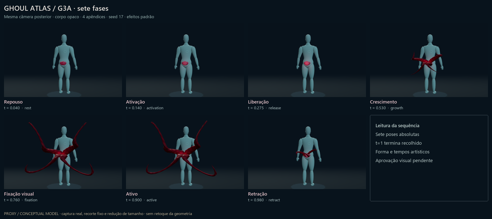

# GHOUL ATLAS — Pacote de revisão visual G3A

24/10/2026, America/Sao_Paulo. Diretório: `artifacts/gates/G3A-review/`. Todas as imagens de cena são **capturas novas da aplicação real**, no build de produção. Composições usam apenas recorte fixo, redução e legendas; originais listados abaixo. Não há renders externos ou referências artísticas usados como resultado.

**Estado:** tecnicamente verificado, aprovação visual pendente. A [avaliação crítica](REPORT.md) prioriza implantação lombar, distinção das fases e ocupação móvel. Nenhuma funcionalidade foi alterada; sem commit, push, deploy ou início de outra fase.

Pacote de aproximadamente **9,5 MiB**, com 42 screenshots originais, sete painéis e um vídeo. Os primeiros links abaixo concentram a revisão; os demais arquivos preservam a evidência completa.

## Percurso compacto de revisão

| Material | Caminho no pacote |
|---|---|
| Comparação das sete fases | [01-seven-phases.png](01-seven-phases.png) |
| Oito frames de crescimento, com `t` | [02-growth-sequence.png](02-growth-sequence.png) |
| Posterior × lateral do Rinkaku ativo | [03-active-views.png](03-active-views.png) |
| Mobile durante reprodução automática | [mobile-playing.png](mobile-playing.png) |
| Vídeo real de um ciclo completo | [playback.webm](playback.webm), aproximadamente 3,63 MiB |
| Materiais, luz, deformação, raízes e parecer crítico | [REPORT.md](REPORT.md) |
| Arquivos implementados e responsabilidades | [INVENTORY.md](INVENTORY.md) |



## Sete fases — originais completos

Todos em 1440×900/DPR1, câmera posterior fixa, quatro apêndices/seed17/padrão, partículas habilitadas e corpo opaco. `t` é coordenada artística normalizada, sem tempo biológico ou fórmula RC. Movimento reduzido congela estes quadros.

| Fase | Intervalo | `t` capturado | Arquivo |
|---|---|---:|---|
| Repouso / rest | `[0,.08)` | .040 | [phases/01-rest.png](phases/01-rest.png) |
| Ativação / activation | `[.08,.20)` | .140 | [phases/02-activation.png](phases/02-activation.png) |
| Liberação / release | `[.20,.35)` | .275 | [phases/03-release.png](phases/03-release.png) |
| Crescimento / growth | `[.35,.67)` | .530 | [phases/04-growth.png](phases/04-growth.png) |
| Fixação visual / fixation | `[.67,.85)` | .760 | [phases/05-fixation.png](phases/05-fixation.png) |
| Ativo / active | `[.85,.95)` | .900 | [phases/06-active.png](phases/06-active.png) |
| Retração / retract | `[.95,1]` | .980 | [phases/07-retract.png](phases/07-retract.png) |

`t=1` termina recolhido; não é o estado ativo final. O repouso ainda mostra o proxy rosa preexistente do kakuhou, que não deve ser confundido com anatomia final.

## Oito frames sequenciais

Originais do visor, sem alterar a câmera; `.700` já pertence à fixação e foi mantido como referência do fim do crescimento.

| Quadro | `t` | Arquivo |
|---|---:|---|
| 1 | .350 | [growth/t350.png](growth/t350.png) |
| 2 | .400 | [growth/t400.png](growth/t400.png) |
| 3 | .450 | [growth/t450.png](growth/t450.png) |
| 4 | .500 | [growth/t500.png](growth/t500.png) |
| 5 | .550 | [growth/t550.png](growth/t550.png) |
| 6 | .600 | [growth/t600.png](growth/t600.png) |
| 7 | .650 | [growth/t650.png](growth/t650.png) |
| 8 | .700 | [growth/t700.png](growth/t700.png) |

## Vistas e mobile

- [views/active-posterior.png](views/active-posterior.png): posterior real do controle, `t=.900`, superfície opaca.
- [views/active-lateral.png](views/active-lateral.png): lateral real, `t=.900`, mesma configuração.
- [mobile-playing.png](mobile-playing.png): 390×844/DPR1, toque, reprodução automática em crescimento. O clock passou de `.522217` a `.524983` durante o screenshot; a UI amostrada a 4 Hz mostra `.518`. Não foi congelada artificialmente uma pose fingindo movimento.

## Diagnósticos visuais complementares

| Comparação | Arquivo |
|---|---|
| Retração `.950/.960/.970/.980/.990/.995/1.000` | [04-retraction.png](04-retraction.png) |
| Seis limites de fase, antes/depois ±.001 | [05-phase-transitions.png](05-phase-transitions.png) |
| Foco lombar em crescimento, ativo e retração | [06-root-details.png](06-root-details.png) |
| Repetição `.700→.200→.700→.300→.700` | [07-scrub-revisit.png](07-scrub-revisit.png) |

Fontes completas desses painéis:

- Raízes: [diagnostics/root-growth.png](diagnostics/root-growth.png), [root-active.png](diagnostics/root-active.png), [root-retract.png](diagnostics/root-retract.png). O foco local da aplicação corta as extremidades distantes; serve à inspeção da junção.
- Fronteira `.080`: [t.079](diagnostics/boundary-t079.png) / [t.081](diagnostics/boundary-t081.png).
- Fronteira `.200`: [t.199](diagnostics/boundary-t199.png) / [t.201](diagnostics/boundary-t201.png).
- Fronteira `.350`: [t.349](diagnostics/boundary-t349.png) / [t.351](diagnostics/boundary-t351.png).
- Fronteira `.670`: [t.669](diagnostics/boundary-t669.png) / [t.671](diagnostics/boundary-t671.png).
- Fronteira `.850`: [t.849](diagnostics/boundary-t849.png) / [t.851](diagnostics/boundary-t851.png).
- Fronteira `.950`: [t.949](diagnostics/boundary-t949.png) / [t.951](diagnostics/boundary-t951.png).
- Retração: [t.950](diagnostics/retract-t950.png), [t.960](diagnostics/retract-t960.png), [t.970](diagnostics/retract-t970.png), [t.980](diagnostics/retract-t980.png), [t.990](diagnostics/retract-t990.png), [t.995](diagnostics/retract-t995.png), [t1.000](diagnostics/retract-t1000.png).
- Revisita: [antes](diagnostics/revisit-0700-before.png) / [depois](diagnostics/revisit-0700-after.png); diferenças de pixels RGB e de geometria foram zero neste percurso.

## Proveniência, verificações e reprodução

- [captures.json](captures.json): estado real por captura, configuração, opacidade, câmera, raiz/pontas, SHA-256, ciclo automático e preservação dos arquivos anteriores.
- [compositions.json](compositions.json): fontes, recortes e hashes dos sete painéis; comparação de pixels da revisita.
- [geometry-review.json](geometry-review.json): diagnóstico offline de 201 poses e das fronteiras, sem alterar o motor.
- [checks.json](checks.json): TypeScript, lint, 121 testes unitários e build desta revisão, todos passaram. O build validou o catálogo.
- Logs: [typecheck](check-typecheck.txt), [lint](check-lint.txt), [unitários](check-test.txt), [build](check-build.txt), [captura/smoke](capture-run.txt).
- [verify-review.json](verify-review.json): links, hashes, imagens/vídeo e ausência de mudança dos 68 arquivos observados e 58 imagens anteriores.

Scripts mantidos para reprodução a partir da raiz do projeto, com as ferramentas já documentadas no ambiente:

```powershell
npm run build
npm run preview -- --port 4173
# Em outro terminal, com Chromium Playwright disponível:
node artifacts/gates/G3A-review/capture.mjs
node tools/python.mjs artifacts/gates/G3A-review/compose.py
node artifacts/gates/G3A-review/analyze-geometry.mjs
node artifacts/gates/G3A-review/verify.mjs
```

O diagnóstico `.mjs` importa TypeScript diretamente com o Node24.22.1 já usado nesta máquina; isso não altera os requisitos do aplicativo. `PLAYWRIGHT_CHROMIUM_EXECUTABLE_PATH` e `ATLAS_PYTHON` podem apontar às ferramentas locais existentes conforme [guia de ambiente](../../../docs/RESUME_ON_NEW_PC.md). Pillow12.3.0 já estava disponível. Nenhuma instalação nova foi necessária.

As 42 capturas e os sete painéis são evidência visual; o vídeo demonstra movimento real, não uma nova medição de FPS. Emulação mobile não aprova GPU ou ergonomia de um telefone físico. Todos os modelos, cronologia e materiais continuam **PROXY / CONCEPTUAL MODEL / hypothetical_model**. A decisão de aprovar a aparência permanece com o usuário.
