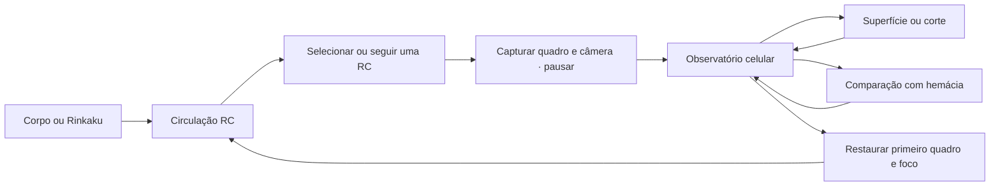

# G4B — RC Cellular Observatory

**Plano aprovado · 25/11/2026 · elaborado sobre `7085f1c2f6237724baad4f73d1d1f6f7a8aa5204`.** O PR #4 integrou o plano em `987ef434050fa2fa8e2c29ff8509c3242f6b3364`. O [aceite G4B](G4B_ACCEPTANCE.md) registra a implementação P1 subsequente em `codex/g4b` e suas verificações.

## Base recuperada

| Referência | O que orienta G4B |
|---|---|
| [Prompt G4 original](../prompts/04_CORRENTE_SANGUINEA_RC.md), [roteiro](02_EXPERIENCE_STORYBOARD.md), [simulação § B](04_SIMULATION_SPEC.md) e [roadmap § G4](01_ROADMAP_AND_GATES.md) | Aumentar a RC selecionada, oferecer versões esquemática e interpretativa e voltar ao foco anterior. A montagem entre células mencionada na proposta original fica fora deste recorte. |
| [G4A](G4A_ACCEPTANCE.md), [G4A.1](G4A1_REFINEMENT.md) e [contrato vascular](G4A_BLENDER_CONTRACT.md) | Identidades estáveis, perfis 100/500/2.000, amostragem absoluta, câmera dependente dos obstáculos, retenção Body/Micro e descarte verificado. |
| [Projeto de arquitetura](03_TECHNICAL_ARCHITECTURE.md), [governança](06_CANON_AND_DATA_RULES.md), [QA](08_QUALITY_ASSURANCE.md) e [G2A](BLENDER_WEB_INTEGRATION.md) | Limites de cada camada, validação por afirmação, orçamento, autoria e aquisição de GLB por contrato. |
| [UI-R1](UI_R1_ACCEPTANCE.md), [UI-R2](UI_R2_ACCEPTANCE.md), [UI-R3](UI_R3_ACCEPTANCE.md), [UI-R4](UI_R4_ACCEPTANCE.md) e [UI-R5](UI_R5_REVIEW.md) | Entrada sem WebGL na Home, ferramentas sobre o palco, abas e foco, suspensão de sessões, identidade Limiar e acessibilidade responsiva. |

A busca no checkout principal, refs Git disponíveis, stashes e anexos locais de texto encontrou o prompt G4 e as especificações parciais acima, sem um prompt dedicado ou implementação G4B recuperável. Os documentos do redesign mencionam possível WIP externo. A auditoria fica limitada às origens acessíveis. A baseline tecnicamente validada é o mesmo conteúdo de código do PR #3 e tem [88 testes E2E](../artifacts/gates/UI-R5-validation.json) registrados.

### Diagnóstico da integração real

- [`routes.ts`](../src/app/routes.ts) reconhece `/atlas/cell/:entityId` por regex e retorna `section: 'cell'` com `href`. Ainda não decodifica ou valida a identidade. [`App.tsx`](../src/app/App.tsx) trata essa seção como editorial e exibe **Inspeção celular indisponível** com link **Voltar ao fluxo**. [`vercel.json`](../vercel.json) já faz rewrite HTML específico dessa rota. Artefato de referência em [390 px](../artifacts/gates/UI-R5-celular-390.png).
- Micro já expõe seleção por instância ou lista, `Seguir célula`, ficha, timeline e os modos Livre/Fluxo/Tracking. O ID semântico tem o formato `rc:<seed>:<índice>`, independente da quantidade de entidades. A presença na população é um teste separado do ID válido. O cálculo determina RC em índices múltiplos de 8 no conjunto 0–1999. É distribuição do demonstrador.
- [`VascularScene.tsx`](../src/scene/vascular/VascularScene.tsx) controla a pose efetivamente aplicada e o `vascularClock`. `useVascular.seconds` publica snapshots discretos e pode estar atrasado durante o play. A pose suavizada da câmera em tracking inclui histórico de apresentação, portanto recomputá-la só a partir do tempo/seed não garante a mesma câmera. Navegar para editorial já suspende a cena e preserva o canvas; essa integração é o ponto de partida.
- [`bodyContext.ts`](../src/scene/bodyContext.ts) demonstra como salvar pose, projeção e alvo, restaurar a câmera após descarregar a inércia e manter preferências globais. O retorno de Micro ao Corpo já usa seu próprio bookmark de histórico. G4B compõe uma segunda etapa acima dessa sessão.

## Escopo e jornada

1. Abrir **Micro** pelo Atlas ou **Explorar a circulação** em Estudos. Selecionar RC presente com clique/toque ou **Células e fluxo**. A barra informa o ID e se está selecionada ou acompanhada.
2. Usar **Seguir célula** para acompanhar o movimento pela câmera existente. **Inspecionar célula** aparece na barra contextual para RC válida e presente, inclusive com a reprodução pausada ou a câmera livre. Uma hemácia selecionada continua disponível na ficha vascular.
3. Acionar **Inspecionar célula**. Gravar a origem e o quadro vascular, trocar de escala de forma explícita e abrir uma cena lazy. Usar transição breve de opacidade, com texto **Abrindo observatório celular…** e **Voltar à circulação** disponíveis durante a carga. Movimento reduzido usa troca direta. A ampliação é uma cena separada com escala ilustrativa.
4. Manipular a RC por órbita, zoom limitado ou vistas acessíveis. Alternar a representação **Esquemático / Interpretativo**. Em **Corte**, mover o plano, escolher seu eixo e voltar a **Superfície**. **Ficha** oferece Estrutura e Evidências para a superfície visível.
5. Abrir **Comparar com hemácia**. Conferir silhueta, perfil e concavidade no mesmo referencial visual, com controles sincronizados e descrições para ambos os objetos. Fechar a comparação devolve a vista, o modo e o corte anteriores.
6. Acionar **Voltar à circulação**, Esc no nível raiz ou Voltar do navegador dentro da sessão. Retornar à mesma RC, câmera, quadro, destaque e configuração. O quadro volta pausado para inspeção estável. Se havia reprodução, o controle principal pode dizer **Retomar reprodução** e continuar do quadro congelado por ação explícita. O retorno posterior da circulação restaura o Corpo/Rinkaku conforme o contrato existente.

**Recorte funcional.** A comparação é morfológica e interna à rota celular. O módulo geral `/atlas/comparar`, G5, G6, novos kagunes, montagem celular e arte P2 estão fora da implementação proposta. A entrada de G4B nasce no fluxo; Home e Estudos continuam com os acessos aprovados na UI-R5.

## Interface e wireframes

Aplicar o cabeçalho atual com marca **Limiar**, a paleta grafite `#100D11`, superfícies `#1A151B` e `#241D25`, marfim `#F0EBE4` e ação carmim `#762735`. Usar Plex Sans Condensed nos títulos, Sans em ações e corpo e Mono para identificadores e valores de cena. O menta `#A6C8C2` indica foco ou seleção com texto, e o âmbar existente identifica a hipótese. O palco ocupa a coluna principal. A barra fora do canvas concentra os controles frequentes. Ferramentas e ficha têm uma sobreposição por vez.

### Desktop · 1440 × 900

```text
┌ Ghoul Atlas / cabeçalho Limiar             Atlas   Estudos   Fontes  Ajuda ┐
│ Atlas / Micro / Célula RC                     [← Voltar à circulação]   │
│ Observatório celular     rc:17:0                  Escala ilustrativa    │
├──────────────────────────────────────────────────────────────────────────┤
│                                                                          │
│                       RC selecionada em 3D                              │
│                  (arrastar para girar e aproximar)       Ficha, aberta  │
│                                                           sob demanda   │
│                                                           ┌──────────┐  │
│                                                           │Estrutura │  │
│                                                           │Evidências│  │
│                                                           └──────────┘  │
├──────────────────────────────────────────────────────────────────────────┤
│ [Superfície / Corte] [Representação] [Comparar com hemácia]  [Vista] [Ficha] │
│ △ Modelo conceitual · Escala ilustrativa                     [Reenquadrar] │
└──────────────────────────────────────────────────────────────────────────┘
```

Com Corte ativo, sua folha contém **Eixo do corte** (X, Y, Z), **Posição do plano** em escala normalizada e **Centralizar plano**. Fechar a folha conserva o corte. Em Comparação, o palco contém RC e hemácia lado a lado, os nomes legíveis no DOM e uma legenda persistente **Comparação de forma · escala visual normalizada**. Exibir **Sair da comparação** com acesso por teclado. A ficha abre sobre o palco, sem mudar sua caixa.

### Mobile · 390 × 844 e 430 × 932

```text
┌ Ghoul Atlas                  Menu  Ajuda ┐
│ ← Voltar à circulação                    │
│ Observatório celular    rc:17:0           │
├──────────────────────────────────────────┤
│                                          │
│            RC em destaque               │
│         Órbita e zoom por toque          │
│                                          │
│ △ Modelo conceitual                      │
├──────────────────────────────────────────┤
│ [Superfície] [Corte] [Ficha]              │
│ [Representação] [Comparar com hemácia]    │
│ [Vista / zoom / reenquadrar]              │
└──────────────────────────────────────────┘

  Ao abrir Ficha / Corte / Vista
  ┌──────────────────────────────────────┐
  │ Nome da ferramenta           Fechar │
  │ Controles ou Estrutura | Evidências │
  │ Conteúdo em rolagem interna         │
  └──────────────────────────────────────┘
```

A comparação mobile usa alternância **Célula RC / Hemácia** no palco com a mesma orientação e aproximação. Preservar descrições e aviso visíveis nas duas opções. O rodapé de ferramentas pode rolar com a página em altura curta. Em 320 px/zoom 200% e paisagem, permitir reflow em uma coluna e alcançar todas as ações sem rolagem horizontal. Controles primários têm alvos de 44 px, foco visível e alternativa HTML a cada gesto.

### Estados e textos

| Estado | Tratamento |
|---|---|
| RC ausente na população atual | Micro conserva o aviso existente e explica que é possível selecionar outra RC ou mudar o perfil. Sem abrir outra entidade silenciosamente. |
| URL inválida, hemácia na rota ou ID inexistente | **Célula indisponível** e **Abrir circulação**. Nenhum canvas celular, seleção fabricada ou exceção de decodificação. |
| URL direta válida | **Célula RC · acesso direto**. Renderizar pelo ID validado e abrir circulação em sessão nova se não houver bookmark. Explicar **O fluxo abrirá no início** nesse retorno. |
| Falha de carregamento/WebGL | **Visualização 3D indisponível**, vista esquemática estática com descrição textual, classes/fontes, **Tentar novamente** e rota de retorno. Seleção HTML e leitura de evidências continuam úteis. |

## Arquitetura proposta

| Camada | Reaproveitar | Acrescentar após aprovação |
|---|---|---|
| Navegação | `src/app/routes.ts`, `App.tsx`, histórico SPA por sessão, `AtlasWorkspace`, rewrites de Vercel | Rota celular tipada, `cellHref`, decodificador e bookmark celular. Manter Micro residente e inerte enquanto o workspace irmão de inspeção está ativo. |
| Integração vascular | `src/ui/VascularWorkspace.tsx`, `src/state/vascular.ts`, `VascularScene`, `createEntity` / `entityIndexFromId` / `entityPresent` | Ação contextual e ponte de captura/restauração com controller da câmera. Alterações de integração limitadas ao estacionamento/retorno, sem alterar trajetórias, instancing, bounds ou algoritmo de tracking. |
| Interface 3D | `AtlasHeader`, `ExplorerPanel`, `InspectionTabs`, `EvidenceSources`, `EvidenceFilter`, `SceneBoundary`, tokens da bancada | `InspectionWorkspace` com palco, seleção, ações e arquivos de estilos focados. `CellWorkspace` resolve identidade, rótulos e escolhas do estudo. `InspectionScene` lazy cuida de vistas, órbita, zoom, picking e recorte. |
| Modelo | IDs já produzidos por `vascular.ts` e morfologias como referência em `ProceduralVascularAdapter` | `src/simulation/cellular.ts` para parâmetros puros e `src/scene/inspection/` para adapter de recursos. `src/content/cellularEvidence.ts` compõe os cartões existentes e a descrição do novo corte. |
| QA | `ui-r1.spec.ts`, `vascular.spec.ts`, `ui-r4-audit.mjs`, `g4a1-production-profile.js` | Testes puros de rota/snapshot/modelo, `tests/e2e/g4b-cellular.spec.ts`, perfil de produção e arquivos de evidência G4B. |

Reutilizar apenas as partes que têm um segundo caso concreto no próprio G4B. O contrato de inspeção oferece geometria, bounds, focos opcionais, legenda, modo de superfície e plano. A RC e a hemácia provam a fronteira. Tecidos e órgãos futuros poderão implementar o mesmo contrato quando houver necessidade. A rota, o bookmark vascular, a taxonomia RC e a comparação específica ficam fora do componente genérico.

### Contratos e fronteiras

| Contrato proposto | Campos e invariantes |
|---|---|
| `CellEntityRef` | `{ kind: 'rc', id, seed, index }`. Decodificar um segmento uma vez com tratamento de erro. Verificar seed de 32 bits canônica, índices 0–1999, tipo RC e round-trip por `entityIndexFromId`. ID no caminho, sem `instanceId`, relógio/câmera na URL ou busca remota por string. |
| `InspectionSubject` | ID semântico, tipo, revisão do modelo, título, classes/fontes, limites locais, âncoras opcionais e modos disponíveis. Aparência em coordenadas centradas e normalizadas. Provém de função pura por ID, representação e revisão. |
| `InspectionViewState` | Representação `schematic` ou `interpretive`, superfície/corte, eixo `x`, `y` ou `z`, posição finita normalizada `[-1, 1]`, objeto ativo em comparação, seleção local de superfície/corte e pose própria. Muda por eventos de UI, com zoom limitado pelo envelope. |
| `InspectionRendererAdapter` | Modelos entregam objetos/âncoras/bounds, mapeamento de hit para ID de leitura, sincronização de corte e `dispose()` idempotente. Seu ownership é local ou via lease explícito. Sem referência a stores de transporte. |
| `VascularInspectionSnapshot` | Bookmarked origin route/entry token, segundos absolutos, `wasPlaying`, velocidade e multiplicador, configuração seed/contagem, seleção, destaque, modo/revisão de câmera. Câmera efetiva contém posição, quaternion, up, alvo, projeção e estado de controles. Preservar referência do rig adaptativo residente ou capturar seu estado necessário quando houver remontagem. Sem buffers, canvas ou recursos Three no snapshot. |
| `InspectionOrigin` | Unido discriminado entre origem vascular estacionada e acesso direto. Chave de sessão e ID da entrada no `history.state`; snapshot em memória por entrada, com descarte quando sua entrada é invalidada e ao encerrar sessão. Sem serialização em storage, URL ou diagnóstico global. |

### Captura, pausa, retorno e histórico

- **Antes do push da rota.** Resolver a entidade presente no perfil e aceitar uma transição por vez. O controller captura o tempo do último quadro aplicado, conferindo a revisão do relógio/vista. A leitura usa o relógio de render, não o número arredondado da timeline. Se um scrub ou seleção ainda está pendente, esperar o próximo quadro correspondente com cancelamento por navegação. Em fallback sem canvas, registrar câmera ausente e valores do store. Confirmar a cópia e pausar na mesma transação síncrona, sem permitir avanço entre os dois passos. Guardar também painel/aba vascular, posição de rolagem e foco de origem.
- **Durante a inspeção.** Manter `VascularWorkspace` e o Body anterior montados, invisíveis, inertes e com render suspenso. Respeitar `prefers-reduced-motion` e seleções locais do usuário. Nenhum atalho celular deve agir sobre a bancada estacionada. O token de navegação invalida resultados atrasados de importação/asset e ações stale após Back, retry, mudança de rota ou duplo toque.
- **Ao voltar.** Resolver o bookmark de origem e aplicar clock, configuração, seleção e pose antes do primeiro frame vascular visível. Inibir atualização da câmera adaptativa, clamp ou resíduo de OrbitControls que recalcule a pose no primeiro frame e enquanto pausada sem comando. Preservar a orientação à letra na mesma dimensão. Em resize, manter pose/target e recalcular a projeção que depende do viewport. A preferência atual de movimento reduzido prevalece sobre inércia salva. Restaurar painel/aba e foco no comando de origem quando existir, com fallback na barra de seleção. A sequência de recuperação usa a foto do primeiro quadro e a pose dos quadros seguintes, não só igualdade do store.
- **Histórico.** Push preserva a entrada própria de Micro e seu retorno anterior. Back dentro da sessão restaura o bookmark; Forward cria nova inspeção do mesmo ID e, se vindo de Micro ativo, recaptura o quadro coerente da origem. Uma navegação genérica para Micro não deve consumir o bookmark de outra entrada. Entrada direta, refresh ou token expirado volta por rota interna, sem `history.back()` cego. Um retorno direto válido pode usar `microSeed` e nova query opcional `microSelect` validadas para abrir Micro em `t=0`, pausado, com o menor perfil de 100/500/2.000 que contém o ID. Rejeitar combinação inválida e manter defaults documentados.
- **Esc por nível.** Ajuda/menu modal → ferramenta ou ficha ativa → sair da comparação → voltar à circulação. Em Micro permanece o Esc já aprovado: fechar ferramenta → soltar tracking → retornar a Corpo/Rinkaku. Inputs, abas e controles nativos mantêm suas teclas. Atalhos de caractere respeitam a preferência UI-R4. Cada nível consome Esc uma única vez.



## Geometria, materiais e escala

- **RC esquemática.** Malha fechada original com contorno suavemente lobulado, iluminação difusa e detalhes reduzidos. Marcadores opcionais apontam ao contorno e à interseção do plano. **Interpretativa.** A mesma leitura de silhueta do fluxo com relevo procedural autoral moderado, material mate carmim escuro e luz lateral suave. Variação determinística por seed/índice e revisão, com envelope e render repetíveis após remount. Sem atribuir camadas, peso ou função ao relevo.
- **Superfície.** Órbita e zoom enquadram o volume. Escolher vista frontal, lateral e oblíqua via DOM. Seleção por hit test associa o objeto ou contorno selecionado ao mesmo item da ficha que a alternativa textual. A luz ajuda a ler o volume em todos os ângulos. Evitar emissão excessiva, rotações automáticas e sobreposição de marcações.
- **Corte conceitual.** Plano local da malha, eixo discreto e posição normalizada. Clipping fica no material próprio da sessão celular, com interseção/contorno calculado sobre triângulos com atualização por comando e buffers reutilizáveis. Uma superfície de corte fechada prepararia uma interpretação de interior; o P1 usa a borda de interseção e seção sem diferenciação anatômica. O filtro do picking usa o mesmo lado do plano para ignorar triângulos recortados. Comparação em superfície conserva e restaura o ajuste anterior de corte.
- **Hemácia.** Proxy autoral de disco bicôncavo com centro mais fino e contínuo, sem furo. Câmera e iluminação equivalentes nos dois objetos. Normalizar o envelope de cada modelo para comparar forma, manter as proporções internas de cada um e avisar que o enquadramento não mede tamanho relativo. Se a ficha citar número humano no futuro, vincular à fonte e manter separado da visualização, sem converter para RC.

## Evidências e linguagem

| Classe | Uso no G4B |
|---|---|
| `official` | Reutilizar `claim.g4a.rc.context` e fonte primária para a menção ao acúmulo no kakuhou. A afirmação fica no cartão textual. O texto conferido delimita o alcance. [Young Jump — 喰種](https://youngjump.jp/tokyoghoul/tg/data/) |
| `real_anatomy` | Reutilizar `claim.g4a.rbc.shape`. A afirmação descreve a forma humana. A geometria da hemácia recebe o aviso de proxy didático. [OpenStax — 18.3 Erythrocytes](https://openstax.org/books/anatomy-and-physiology-2e/pages/18-3-erythrocytes) |
| `inference` | Reservar para interpretação sustentada por evidência e disclaimer identificados. O caminho de zoom e a morfologia autoral entram como escolhas do demonstrador. |
| `hypothetical_model` | Contorno RC, material, comparação normalizada e plano de corte. Novos registros de apresentação com namespace próprio, aviso permanente e `isLoreClaim: false`. |
| `unknown` | Histologia, organelas, dimensões, composição química e mecanismos internos específicos nas fontes conferidas. A ficha explicita o limite da consulta. |
| `manga_needs_verification` | Manter a classe do catálogo para afirmações rastreadas ainda sem suporte primário conferido. O escopo P1 não precisa dessas afirmações. |

As duas páginas foram reconferidas textualmente para o plano, sem incorporar imagens ou promover claims. O filtro existente conserva o aviso de reconstrução mesmo quando oculta hipóteses. Estrutura, Evidências e legenda descrevem o mesmo objeto, inclusive sem WebGL. O aviso do palco **PROXY / CONCEPTUAL MODEL · Escala ilustrativa** acompanha os dois modos. Para o corte, usar **Corte conceitual do modelo. A estrutura interna da célula RC não foi estabelecida nas fontes consultadas.**

## Recursos, Blender e desempenho

**Estratégia inicial.** Importar a bancada celular e seu adapter apenas pela rota ativa. Usar um canvas celular sob demanda, com `frameloop` por invalidação em repouso e o loop breve necessário durante órbita. Comparar no mesmo renderer. Corpo e Micro podem continuar residentes com contexto estacionado, mas o G4B deve ter somente o canvas visível emitindo frames. Desmontar e liberar o canvas celular, geometrias, materiais próprios, controles, subscriptions, timers e leases ao sair. Em falha ou cancelamento, liberar aquisições e tratar o último ID/revisão como único destino válido. Nenhum recurso celular deve aparecer em Home, Corpo ou Micro antes da ação de inspeção. Se os contextos residentes excederem limites reais de mobile, medir descarte estacionado com reidratação exata antes de adotá-lo. O fallback textual continua navegável.

**Dependências de Blender.** O P1 usa procedurais próprios. O checkout contém somente as duas fixtures GLB G2A e nenhum `.blend` ou modelo celular final. A futura entrega licenciada traz `.blend` fonte, GLB autocontido, identificação/revisão/checksum, autoria e licença por recurso, e registro em [ASSET_LICENSES](../public/ASSET_LICENSES.md). Entregar mapa de nodes, materiais, seleção, pivô central, eixos e unidade do export, escala de visualização local e bounds conservadores. Estabelecer correspondência explícita com as convenções G2A, incluindo frente, transformações aplicadas e envelope. Para corte, pedir malha fechada com normais consistentes e topologia revisada, ou interface de seção própria homologada. Para comparação, comprovar centro contínuo da hemácia em três vistas. Arte do fluxo continua sob seu contrato de instâncias e pode usar LOD separado do close-up. O novo adapter usa registro, preflight, cache e leases G2A, sem usar nomes internos como IDs de conteúdo. Falha conserva o proxy rotulado. A aprovação P2 depende de asset concreto, inspeção web e medição.

| Medição proposta | Aceite |
|---|---|
| Home e entrada dos modos existentes | Home fria ≤500 KiB e zero WebGL/renderer/catálogo/GLB. Zero download de chunk, geometria e assets celulares antes da rota de inspeção. Orçamentos UI-R5/G4A continuam vigentes. |
| Nova entrada G4B | Na estação de referência e CDP 20 Mbps / 50 ms, tempo clique → 3D manipulável ≤2,5 s como meta e ≤5 s como teto. Transferência incremental pós-clique ≤250 KiB comprimidos no P1, com cache HTTP desativado e módulos já residentes em Micro devidamente registrados. Medir também URL fria direta até ação real e preservar o teto geral de 8 MiB do observatório. |
| Render desktop | p50 ≥50 FPS e p10 ≥30 em órbita repetível, Superfície, Corte e Comparação. Medir 10 s de warm-up e 30 s ativos por cenário, com 1440 × 900/DPR 1. Orçamento novo ≤30 draw calls no palco celular, inclusive comparação e contorno. Limite geral existente <150 draws no desktop. |
| Mobile e repouso | 390 × 844 e 430 × 932 em emulação com as mesmas verificações de controles e contadores. Perfil físico deve registrar p50 ≥30 FPS como meta de hardware mediano e distinguir indisponibilidade de medição. Sem avanço do clock em célula/aba oculta e sem crescimento de frames em repouso estabilizado. |
| Recursos e regressão | Dez idas/voltas mantêm canvas e UUIDs vasculares em situação normal. Adaptadores celulares ativos voltam a zero após a saída, `criadas = descartadas` nos ciclos e sem incremento líquido em contextos/leases. Registrar geometrias/materiais/texturas, triângulos e heap amostral; contadores não estimam VRAM. Repetir perfis vasculares 100/500/2.000 e tracking representativo desktop/mobile com limites anteriores. |

Em cada relatório, separar fluxo, carga de código/arte, cenário frio direto, modos ativos e repouso. Registrar hardware, browser, versão do build, viewport, DPR, rede, FPS p50/p10, calls e tempos. A baseline UI-R5 de Micro transferiu 495.187 B combinados e usou 3 draws em Fluxo e 4 em Tracking. Os números ancoram a comparação pareada e não são resultados do G4B. [Perfis UI-R5](../artifacts/gates/UI-R5-performance.json)

## Sequência de implementação após aprovação

1. **Contexto e rota.** Fixar provas basais, implementar parser/retorno e teste do snapshot de tracking/fluxo/livre. Testar Back em entrada ainda pendente, acesso direto, reload e fallback antes de produzir a geometria.
2. **Interação 3D P1.** Construir a cena e adapter procedurais, órbita/zoom e vistas equivalentes por teclado. Ligar superfície, corte e picking às fichas e ao wrapper comum.
3. **Comparação e revisão.** Integrar a hemácia normalizada e estados responsivos, conferir textos e evidências. Cobrir ownership, cancelamento e context loss. Capturar e perfilar build final, registrar riscos e publicar o PR de `codex/g4b` para avaliação.

## Critérios de aceite futuros

| Área | Prova obrigatória |
|---|---|
| Fluxo principal | E2E com seleção real do canvas e alternativa HTML, acompanhamento em movimento, entrada por RC, órbita/zoom, troca de modos, plano que recorta a malha, comparação e caminho completo até Micro e Corpo/Rinkaku. Snapshots do renderer validam a interação. |
| Contexto exato | Dez ciclos alternando tracking em reprodução, livre manual e fluxo. Na mesma largura, segundos/config/seleção iguais ao snapshot e nenhuma mudança no hash de transformadas. Para pose efetiva, distância de posição/alvo/up ≤1e−7 e métrica de rotação `1 − abs(dot(q, qOriginal)) ≤ 1e−12` para quaternions unitários. Conferir primeiro quadro visível e quadros pausados seguintes. Verificar canvas/recursos, painel, foco, posição de rolagem e retomada por ação explícita. |
| Robustez de rotas | Cobrir Back/Forward, reload, URL válida sem origem, seed de 32 bits, RC ausente do perfil, hemácia rejeitada na rota RC, URL malformada, dupla entrada, cancelamento e retry. Falha de GLB/catálogo não se transforma em sucesso HTML. |
| Modelo determinístico | Unidades de ID, seed e versão, modos, normals/bounds finitos, repetição após remount e alternância de vista, plano nas extremidades e consistência de hit. A máscara recortada não seleciona partes invisíveis. Comparação mantém alinhamento, zoom, nomes e ressalvas. |
| Acessibilidade | Teclado, toque, zoom, foco visível e ordem de Tab, restituição de foco, Esc hierárquico e movimento reduzido testados. Axe em repouso, corte, comparação, ficha e fallback em desktop e 390/430 px, sem violações nas regras executadas. Verificação manual de resultados inconclusivos, 4,5:1 no texto comum e 3:1 em controles/foco. WebGL indisponível mantém ficha e retorno. |
| Regressão e desempenho | TypeScript, lint, unitários, Python, catálogo v2, build, suíte E2E completa e perfis antigos+novos. Manter o caso de tracking contínuo com 2.000 e ≥42 s reais, dez contextos Body/Micro, GLB e Rinkaku. Provas de suspensão e descarte com contadores. |
| Aprovação visual e científica | Capturas reais `artifacts/gates/G4B-desktop.png` e mobile, mais ângulos dos dois modelos, superfície, corte, comparação, ficha, fallback e retorno à mesma RC. Preservar evidências antigas. Registrar cena/ID/seed/tempo/revisão e parecer humano separado dos testes. Nenhuma promoção de anatomia RC ou de P2. |

Os casos existentes que verificam o placeholder em uma URL RC válida passam a testar o comportamento funcional da mesma rota. Preservar as asserções de Comparar indisponível, URL inválida, ausência de canvas vascular na entrada fria celular e integridade das rotas de JSON/GLB ausentes.

## Riscos e decisões para aprovação

| Risco | Mitigação |
|---|---|
| Pausa ou inércia muda a câmera antes do snapshot | Transação com controller e revisão aplicada. Verificação em tracking real, durante movimento ativo e durante scrub, com tolerâncias separadas de resize. |
| Race entre Back e assets lazy | Token por visita, abortar aquisição, desmontar proprietário, ignorar resultado obsoleto e preservar botão de retorno durante fallback. |
| Três contextos residentes em aparelhos limitados | Uma única cena ativa, medir context loss e descarte. Preservar caminho textual. Validar reidratação exata antes de mudar política de residência. |
| Corte ou comparação escala induz leitura histológica | Exibir legenda permanente, escala normalizada e contorno sem organelas. Pareamento de luz/vista e revisão editorial por afirmação. |
| Shader/material complexos comprometem picking e FPS | PBR mate e clipping local, reaproveitar buffers e testar os hits versus a máscara. Comparação em um renderer e sem pós-processamento obrigatório. |
| Arte definitiva ausente e leitura de close-up ainda P1 | Procedural licenciado do projeto com contrato de substituição. Blender, mobile físico, Safari e leitores de tela precisam de verificação própria. |

## Verificações da retomada

- `git fetch origin`, `git switch main` e `git merge --ff-only origin/main` confirmaram `7085f1c2f6237724baad4f73d1d1f6f7a8aa5204`. A árvore iniciou limpa na pasta principal. O diff entre o conteúdo validado de UI-R5 (`58c96bf`) e o merge atual ficou vazio.
- `npm.cmd run typecheck`, `npm.cmd run lint`, `npm.cmd test -- --maxWorkers=2` (206), `npm.cmd run test:catalog` (22 Python) e `npm.cmd run build`, com catálogo público v2, concluíram com exit 0.
- No preview de produção, dois E2E atuais em `tests/e2e/ui-r1.spec.ts` passaram. Eles cobrem diagnósticos e rotas reservadas, mais a suspensão de Micro por navegação editorial sem mudar identidade, pose e renderer.
- Uma captura nova local em 390 × 844 no Chrome 158 confirmou HTTP 200, título de indisponibilidade, link para `/atlas/vascular` e zero canvas na rota atual. A captura e os logs brutos podem ser consultados em `artifacts/local/g4b-plan/`; a [captura versionada da UI-R5](../artifacts/gates/UI-R5-celular-390.png) mostra o mesmo estado. As 88 regressões completas, auditoria e perfis citados pertencem ao build validado da UI-R5. Os testes da futura rota G4B permanecem critérios de saída.

**Decisões propostas para aceite.** Retorno pausado no quadro exato com retomada explícita. Corte exibido como interseção de uma malha conceitual. Comparação de forma com envelopes normalizados, lado a lado no desktop e alternância no mobile. Ingresso Blender posterior ao P1. A aprovação deste plano autoriza iniciar somente G4B em `codex/g4b`.
