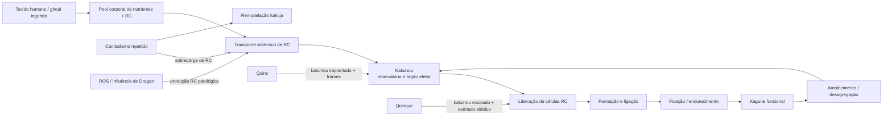
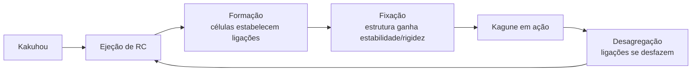
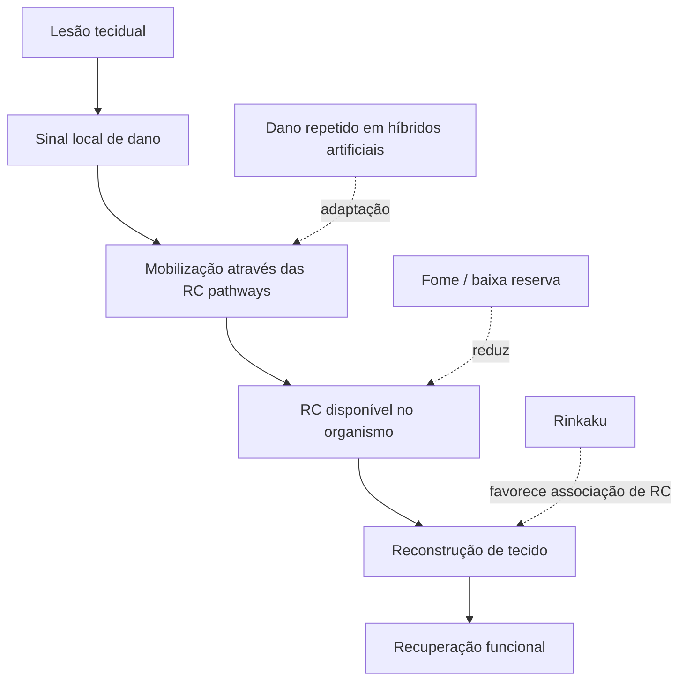
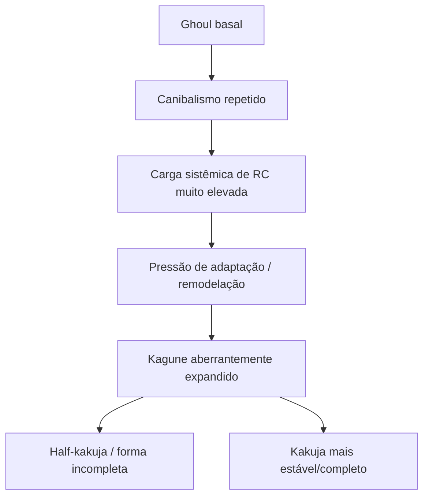
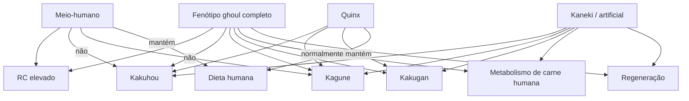

# Anatomia e fisiologia dos ghouls em *Tokyo Ghoul*: relatório canônico e anatomofisiológico

> **Escopo:** mangá *Tokyo Ghoul* + *Tokyo Ghoul:re*, com o mangá de Sui Ishida tratado como cânone primário. Glossários oficiais da Shueisha/Weekly Young Jump e da adaptação televisiva são usados como documentação suplementar. O anime é secundário quando diverge do mangá.  
> **Aviso:** este relatório contém **spoilers integrais**, incluindo Kaneki/Haise, Eto, Arima, Quinx, Kanou, Washuu, ROS e Dragon.

## Resumo executivo

A biologia de *Tokyo Ghoul* é mais coerente quando se evita a ideia simplista de que “RC é energia” ou que “o kagune é um tentáculo guardado dentro do corpo”. O cânone descreve algo mais específico: **humanos e ghouls possuem células RC, mas ghouls mantêm concentrações muito maiores e possuem um órgão especializado, o kakuhou, que acumula RC e permite exteriorizá-las como um tecido predatório temporário — o kagune**. A documentação oficial chama o kagune de uma espécie de **“músculo líquido”**: células RC são liberadas para fora do corpo, conectam-se, endurecem e amolecem repetidamente, o que explica simultaneamente rigidez, mobilidade e mudança de forma. citeturn20search21turn2view0turn1view2

O **fator RC** não é exclusivo dos ghouls. A exposição médica de *Tokyo Ghoul:re* coloca humanos normais aproximadamente na faixa de **200–500**, enquanto a série original apresenta ghouls tipicamente em **1.000–8.000**. Não é dada uma unidade física, nem fica estabelecido que sejam concentrações por volume de sangue; “fator/valor RC” deve ser tratado como um índice biomédico ficcional. Os híbridos e indivíduos modificados demonstram que esse índice não funciona como uma chave binária perfeita “humano = baixo, ghoul = alto”. citeturn27search2turn12search15turn20search14turn20search1

O **kakuhou (赫包)** é a principal inovação anatômica da espécie. Fontes oficiais o descrevem como um órgão ou “bolsa” que acumula células RC obtidas após o consumo de tecido humano. Sua posição anatômica determina a classe de kagune: região dos ombros para ukaku, abaixo das escápulas para koukaku, região lombar para rinkaku e região sacrococcígea para bikaku. O cânone, porém, **nunca fornece histologia microscópica satisfatória do kakuhou**: não sabemos se possui cápsula de colágeno, epitélio, sinusóides, capilares especializados, inervação específica ou qualquer equivalente real. citeturn20search21turn1view1turn1view2

O trato gastrointestinal ghoul é verdadeiramente diferente. Não se trata apenas de “não gostar” de comida. No capítulo inicial de explicação biológica, a incapacidade de aproveitar alimentos humanos comuns é associada a **diferenças enzimáticas/digestivas**, enquanto alterações na língua e no paladar explicam a extrema aversão sensorial. Água e café constituem exceções canônicas, mas Ishida nunca dá uma explicação bioquímica para o café; qualquer teoria envolvendo cafeína, pH ou polifenóis é especulação de fãs. citeturn20search11turn10search12turn20search21turn20search8

A regeneração também parece depender da arquitetura RC, mas **não existe uma fórmula canônica do tipo “X células RC regeneram Y gramas de tecido”**. Rinkaku é explicitamente o tipo de kagune mais associado a regeneração, em razão das propriedades de ligação das suas células RC. Em híbridos artificiais e Quinx, o mangá acrescenta a ideia de **RC pathways**, rotas que se desenvolvem ou se fortalecem no organismo e estão ligadas ao aumento das capacidades RC após dano e adaptação. Isso sugere que o kakuhou sozinho não basta: importa também a integração do sistema RC com o restante do corpo. citeturn1view1turn27search3turn12search4

O canibalismo funciona como uma forma extrema de **sobrecarga/remodelação RC**. Ghouls já possuem alta concentração de RC; comer outros ghouls fornece uma carga especialmente elevada. O consumo repetido pode produzir a transformação conhecida como **kakuja**, na qual kagune alterado envolve partes maiores do corpo, frequentemente como armadura. Porém, canibalismo não implica automaticamente kakuja: predisposição individual e outros fatores existem, e o mecanismo molecular nunca é especificado. citeturn24search1turn23search3

A **ROS — doença de hipersecreção de células RC** — é extremamente importante para interpretar o sistema. Haru Shirazu, uma humana, desenvolve produção patológica de RC e estruturas tumorais semelhantes a tecido de kagune. Mais tarde, o fenômeno Dragon mostra que seres humanos podem sofrer aumento RC e transformações “ghoul-like” sem nascerem ghouls. Isso demonstra que o contraste humano/ghoul não depende simplesmente da presença versus ausência de RC; trata-se de **regulação, quantidade, distribuição, kakuhou e organização sistêmica das células**. citeturn27search4turn27search1turn28search5turn28search6

Finalmente, híbridos demonstram que os fenótipos de ghoul são **modulares**. Um meio-humano pode herdar capacidade física excepcional sem kakuhou ou kagune; um Quinx pode receber um kakuhou e continuar comendo comida humana; Kaneki recebe tecido ghoul e passa a apresentar metabolismo ghoul completo; e ghouls de um olho naturais apresentam combinações ainda diferentes. Portanto, “ter kakuhou”, “ter RC alto”, “ter kakugan”, “precisar comer carne humana” e “regenerar rapidamente” são características relacionadas, mas **não biologicamente inseparáveis**. citeturn25search17turn27search0turn27search2turn27search3

### Modelo sistêmico em uma frase

**Tecido humano → aquisição de substrato/RC → circulação corporal → armazenamento e controle pelo kakuhou → exteriorização e organização de RC → kagune → consumo/reorganização das células**, com regeneração, kakuja, ROS e sistemas híbridos representando variações patológicas ou artificiais desse circuito. A primeira metade desse modelo é explícita no material oficial; os detalhes de circulação e reaproveitamento são parcialmente inferidos. citeturn20search21turn2view0



O diagrama é uma síntese anatômica: o armazenamento no kakuhou, a emissão do kagune e sua capacidade de endurecer/amolecer são canônicos; “pool corporal” e o fechamento completo do ciclo são linguagem fisiológica interpretativa, não termos empregados por Ishida. citeturn20search21turn2view0turn2view1

## Introdução e método

### O que conta como cânone

A fonte de maior autoridade é o **mangá escrito e desenhado por Sui Ishida**, primeiro *Tokyo Ghoul* e depois *Tokyo Ghoul:re*. Para referências anatômicas específicas, capítulos oficiais da Shueisha/Shonen Jump+ e da VIZ foram usados como âncoras. A série original possui 14 volumes e *:re* 16; as páginas oficiais da VIZ disponibilizam o catálogo dos capítulos e identificam Ishida como autor. citeturn19search14turn18search12

Em seguida vêm os **materiais oficiais da Weekly Young Jump/Shueisha**, particularmente o antigo “資料集” (*shiryōshū*, banco de dados/material de referência) dedicado a *Tokyo Ghoul*. Esse material define diretamente ghoul, kakuhou, células RC, kagune, os quatro tipos e quinque. É especialmente valioso porque consolida informações do mangá em terminologia quase enciclopédica. citeturn20search21turn2view0turn1view1turn2view1

O glossário oficial da adaptação televisiva, mantido pela Marvelous, é usado como fonte suplementar. Ele confirma, entre outras coisas, a dieta restrita, armazenamento RC, kagune como órgão predatório, quinque e o comportamento do kakugan. Por ser material de adaptação, perde para o mangá se surgir conflito. citeturn20search8turn1view2

Fontes secundárias foram usadas principalmente para **localizar exposições em capítulos cujo leitor oficial não expõe o texto ao mecanismo de busca** — por exemplo, o diálogo médico de *:re* capítulo 2 ou a identificação de ROS no capítulo 42. Elas não são usadas para substituir o mangá. Em pontos onde o secundário adiciona algo não demonstrável no primário, isso é explicitamente indicado como de menor certeza. citeturn27search2turn12search15turn27search4turn27search1

### Graus de certeza empregados

Neste relatório, **“cânone explícito”** significa informação declarada no mangá ou em material oficial; **“inferência”** é uma conclusão fortemente sugerida por vários fenômenos canônicos; e **“especulação anatômica”** é um modelo que torna a ficção fisiologicamente inteligível, mas que Ishida nunca confirmou.

Essa distinção importa muito em *Tokyo Ghoul*. A obra possui vocabulário biomédico — células, enzimas, transplantes, valores sanguíneos, doenças, tecidos, regeneração — mas não pretende apresentar uma bioquímica completa. Por exemplo, sabemos que RC é uma célula e que pode formar kagune, mas não sabemos seu genoma, composição proteica, metabolismo energético ou mecanismo de diferenciação. citeturn27search2turn2view0

### Anatomia funcional básica

O ghoul externamente é tão semelhante a um ser humano que consegue viver normalmente na sociedade humana. A diferença diagnóstica central apontada pelo material oficial é o **valor RC**, junto aos órgãos e fenótipos derivados dele; o organismo ghoul também apresenta resistência, capacidade predatória e metabolismo alimentar incompatível com alimentos humanos comuns. citeturn20search21turn20search8

Uma maneira útil de pensar nele é:

| Sistema | Humano | Ghoul |
|---|---|---|
| Morfologia externa em repouso | Humana | Essencialmente humana |
| Células RC | Presentes em baixa quantidade | Presentes em quantidade elevada |
| Kakuhou | Ausente | Presente |
| Kagune | Ausente fisiologicamente | Presente |
| Kakugan | Ausente | Tipicamente bilateral quando ativado |
| Dieta | Dieta humana comum | Tecido humano/ghoul; água e café como exceções |
| Regeneração | Humana normal | Muito superior em vários contextos |
| Resistência a armas comuns | Normal | Muito elevada |
| Patologia RC | ROS é possível | Homeostase RC elevada é fisiológica |

A existência de RC em humanos é estabelecida em *:re*; a dieta, kakuhou e resistência são explicitadas pelos guias oficiais. As taxas precisas de regeneração e resistência não são padronizadas, portanto devem ser entendidas qualitativamente. citeturn27search2turn20search21turn1view1

## Células RC e kakuhou

### O que uma célula RC é

“RC” corresponde a **Red Child**, nome associado à aparência microscópica descrita no mangá: a célula apresenta uma forma enrolada que lembra um pequeno feto. A explicação aparece na exposição médica inicial de *Tokyo Ghoul:re*, ao mesmo tempo em que se esclarece que seres humanos também carregam pequenas quantidades de RC. citeturn27search2turn12search15turn15view0

Isso elimina dois equívocos comuns:

**RC não significa “red blood cell”** e, portanto, não é simplesmente a hemácia do universo de *Tokyo Ghoul*. E **RC não é exclusivamente ghoul**. A diferença fundamental é quantitativa e regulatória. citeturn27search2turn12search15

A obra chama essas estruturas de células, mas **não fornece uma citologia completa**. Não há descrição canônica de núcleo, mitocôndrias, membrana, cromossomos, receptores, metabolismo, síntese proteica ou reprodução celular. Mesmo a expressão “Red Child” descreve principalmente sua morfologia visual, não uma classificação histológica real. citeturn27search2turn15view0

### Fator RC

As faixas mais consistentemente apresentadas são:

| Organismo/estado | Fator RC de referência | Interpretação |
|---|---:|---|
| Humano comum | **200–500** | Homeostase humana |
| Região intermediária | **não possui classificação universal** | Pode aparecer em indivíduos modificados |
| Ghoul típico | **1.000–8.000** | Faixa ghoul apresentada na obra |
| Quinx | **variável e monitorado** | Depende do implante, frames e adaptação |
| Meio-humano | **não há faixa canônica geral publicada** | Fenótipo não deve ser deduzido apenas por RC |
| Kakuja / Dragon / ROS | **não existe intervalo universal canônico** | Estados de desregulação/remodelação |

A faixa humana de 200–500 é associada à exposição de *:re* capítulo 2, enquanto a faixa de 1.000–8.000 para ghouls aparece na discussão do fator RC da série original. Esses números são **índices ficcionais sem unidade publicada**; tratá-los como “células por microlitro” seria invenção. citeturn27search2turn12search15turn20search14turn20search1

Também não devemos interpretar 999 como uma barreira bioquímica absoluta e 1.000 como transformação instantânea. Quinx e outros indivíduos modificados mostram que o fenótipo depende de mais que um único número. citeturn27search2turn27search3

### De onde vêm as células RC

O guia oficial estabelece uma cadeia relativamente direta: ao consumir o corpo humano, o ghoul **acumula células RC no kakuhou**. O canibalismo também existe, e como o organismo de outro ghoul já possui alta carga RC, ele fornece um substrato especialmente concentrado. citeturn20search21turn20search8

O que não fica claro é se todas as RC adquiridas são células fisicamente intactas do indivíduo consumido ou se o tecido ingerido fornece matéria-prima que o ghoul converte em novas RC. O mangá emprega linguagem compatível com “incorporar/aumentar RC”, mas não realiza rastreamento celular ou isotópico. Portanto, a frase comum “ghouls roubam literalmente as células RC do humano e as armazenam intactas” vai além do que pode ser demonstrado. citeturn20search21turn24search1

### Circulação

Há forte associação entre RC e o sangue/circulação sistêmica. A patologia ROS é descrita em termos de excesso de células RC no organismo e produz manifestações em locais distantes de um kakuhou normal; exposições posteriores também ligam aumento RC sistêmico a transformação corporal. citeturn27search4turn27search1turn28search5

Entretanto, **não existe um atlas vascular RC**. Não sabemos se as células circulam livres no plasma, em vasos próprios, aderidas a células sanguíneas ou em uma rede completamente distinta. O termo posterior **RC pathways** mostra que vias especializadas de distribuição existem ou se desenvolvem, particularmente em corpos artificialmente modificados, mas sua histologia permanece indefinida. citeturn27search3turn12search4

A formulação mais segura é:

> O sangue funciona como componente do transporte sistêmico de RC, enquanto o kakuhou e as RC pathways regulam sua concentração e mobilização; a microanatomia desses trajetos não é especificada.

### O kakuhou como órgão

**Kakuhou (赫包)** pode ser entendido literalmente como o órgão-reservatório do sistema RC. O material oficial o chama tanto de “órgão” quanto de uma espécie de “bolsa”. Após ingestão de tecido humano, RC se acumula nele; durante ativação, RC é liberado e forma kagune. citeturn20search21turn20search8

Sua importância é demonstrada experimentalmente pelo **quinque**. A CCG remove e processa kakuhou de ghouls mortos; mediante estímulos elétricos, o tecido continua capaz de gerar uma estrutura de kagune artificialmente controlada. Isso indica que parte essencial da capacidade formadora de kagune está localizada no próprio órgão e sobrevive, pelo menos funcionalmente, à excisão e processamento. citeturn2view1

Isso não prova que o kakuhou seja “um segundo cérebro”. Também não existe evidência canônica confiável de que personalidade ou consciência do ghoul permaneçam armazenadas nele. Essa é uma extrapolação frequente em teorias de fãs, não anatomia estabelecida.

### Localização anatômica

A posição funcional do kakuhou acompanha o tipo RC/kagune. O esquema abaixo usa **vista posterior**:

```text
              VISTA POSTERIOR — ESQUEMA NÃO EM ESCALA

                    ┌─────────────┐
                    │   CABEÇA    │
                    │  Kakugan    │ ← manifestação ocular, não kakuhou
                    └──────┬──────┘
                           │
              ┌────────────┴────────────┐
              │       OMBROS            │
              │    UKAKU / 羽赫          │
              │  origem superior dorsal │
              └────────────┬────────────┘
                           │
              ┌────────────┴────────────┐
              │   ABAIXO DAS ESCÁPULAS  │
              │    KOUKAKU / 甲赫        │
              │  estrutura mais densa   │
              └────────────┬────────────┘
                           │
              ┌────────────┴────────────┐
              │    REGIÃO LOMBAR        │
              │    RINKAKU / 鱗赫        │
              │ tentáculos regenerativos│
              └────────────┬────────────┘
                           │
              ┌────────────┴────────────┐
              │ SACRO / CÓCCIX          │
              │   BIKAKU / 尾赫          │
              │     forma caudal        │
              └─────────────────────────┘
```

As quatro posições e suas propriedades são descritas diretamente pelo banco de dados oficial da Young Jump. citeturn1view1

**Referência visual oficial:**  
`https://youngjump.jp/tokyoghoul/tg/data/index03.html`

A página acima contém a documentação gráfica oficial dos quatro tipos. citeturn1view1

### Histologia: o que sabemos e o que não sabemos

Não há no cânone uma lâmina histológica do kakuhou. O mangá não estabelece camadas equivalentes a mucosa, submucosa, cápsula, parênquima ou estroma. Também não esclarece se RC é sintetizada no órgão ou simplesmente concentrada ali. O fato de o órgão armazenar RC e responder a estímulos após processamento demonstra função, não microestrutura. citeturn20search21turn2view1

**Especulação anatômica, não cânone:** para cumprir simultaneamente armazenamento, liberação rápida, regeneração e resposta elétrica, um kakuhou biologicamente plausível precisaria ter algo funcionalmente equivalente a uma região de armazenamento altamente vascularizada, matriz que tolerasse densidades extremas de RC e vias de saída capazes de direcionar células à superfície corporal. Isso faria dele uma mistura funcional de reservatório vascular, órgão secretor e tecido progenitor — mas Ishida nunca define essas estruturas.

### O melhor análogo bioquímico para RC

Não existe equivalente humano único. Funcionalmente, RC se comporta **como se combinasse** quatro propriedades:

| Analogia funcional | O que ela ajuda a explicar | Por que não é equivalência |
|---|---|---|
| Substrato circulante | RC pode ser quantificado no organismo | Não sabemos como é transportado |
| Célula progenitora | Regeneração e produção de novo tecido | Não há diferenciação celular descrita |
| Material estrutural programável | Kagune assume forma, rigidez e elasticidade | Nenhum polímero real é identificado |
| Reserva metabólica | Fome, alimentação e desempenho estão conectados | RC nunca é definida como ATP ou “caloria” |

O ponto importante é não reduzir RC a “mana biológica”. O cânone insiste que ela é uma **célula**, mas concede a essa célula propriedades mecânicas e regenerativas impossíveis na biologia real. citeturn27search2turn2view0

## Kagune, kakugan e biomecânica

### Kagune como órgão temporário exteriorizado

O kagune (赫子) é chamado oficialmente de **órgão predatório** e é formado quando células RC armazenadas no kakuhou são liberadas para fora do corpo. Essas células podem comportar-se de maneira fluida e, em seguida, formar material mais duro que dentes; o guia usa a expressão “músculo líquido”. citeturn2view0turn1view2

Essa descrição é muito útil: o kagune não é melhor imaginado como “uma espada escondida sob a pele”. Ele é mais semelhante a um **tecido extracorpóreo que se monta sob demanda**.

A mecânica oficial envolve alternância entre estados endurecidos e amolecidos. Ao controlar essa transição, o ghoul consegue dobrar, chicotear, perfurar, bloquear e alterar a forma do kagune. citeturn2view0

### Ciclo de formação

A exposição da obra é normalmente sistematizada em três estágios:

**formação → fixação → desagregação**.

No estágio de formação, RC expelidas estabelecem ligações; durante fixação essas ligações mantêm a forma e resistência; na desagregação, a associação se desfaz, permitindo retração ou reconstrução. Essa nomenclatura é preservada em índices japoneses da obra e corresponde ao comportamento mostrado no mangá. citeturn15view0



A ideia de ligação e desagregação é coerente com a definição oficial do kagune como material que alterna entre estados duros e flexíveis. citeturn2view0turn15view0

### Tipos de kagune

A classificação canônica é determinada pela localização do kakuhou e pelas propriedades mecânicas do tecido RC. citeturn1view1

| Tipo | Localização | Morfologia típica | Propriedade dominante | Limitação característica | Afinidade |
|---|---|---|---|---|---|
| **Ukaku 羽赫** | ombros | asas/cristais/projéteis | leveza, velocidade, combate à distância | elevado consumo de energia e menor desempenho prolongado | forte contra bikaku |
| **Koukaku 甲赫** | abaixo das escápulas | lâmina, escudo, armadura | densidade, rigidez e defesa | pesado, relativamente lento | forte contra ukaku |
| **Rinkaku 鱗赫** | lombar | tentáculos | potência, flexibilidade, regeneração | ligações RC relativamente frágeis | forte contra koukaku |
| **Bikaku 尾赫** | cóccix | cauda | equilíbrio entre força, velocidade e defesa | menos especialização extrema | forte contra rinkaku |

A Young Jump descreve ukaku como leve e veloz, koukaku como o mais robusto porém pesado, rinkaku como especialmente regenerativo e bikaku como o tipo mais equilibrado. Também formaliza o ciclo de vantagens. citeturn1view1

O ciclo pode ser representado assim:


Isso não é um “pedra-papel-tesoura” absoluto. A obra mostra repetidamente que quantidade de RC, experiência, força do usuário, quinque, estratégia e anatomia individual podem superar a vantagem de tipo. A tabela oficial descreve **compatibilidade**, não destino automático da luta. citeturn1view1

### Por que rinkaku regenera mais

A explicação oficial é incomumente específica: no rinkaku, as células RC têm facilidade para se associar, favorecendo enorme capacidade regenerativa; porém, as ligações individuais são comparativamente frágeis, o que torna a estrutura do kagune menos resistente a impactos que um koukaku. citeturn1view1

Isso gera uma elegante troca biomecânica:

**ligações fáceis de reconstruir → regeneração rápida**, mas  
**ligações menos estáveis → menor resistência estrutural local**.

É um dos poucos casos em que Ishida conecta diretamente comportamento “celular” a uma propriedade macroscópica do kagune. citeturn1view1

### Controle neurológico

O mangá demonstra controle voluntário extraordinariamente preciso: usuários alteram direção, dividem apêndices, criam escudos, lâminas, projéteis ou estruturas complexas. O cânone, porém, nunca mostra nervos entrando no kagune nem explica como potencial de ação, propriocepção ou feedback sensorial atravessam o tecido RC.

**Inferência:** deve existir alguma forma de comunicação entre sistema nervoso e sistema RC/kakuhou, porque o movimento é intencional e responsivo.  
**Não canônico:** afirmar que RC são neurônios, que carregam impulsos elétricos como axônios ou que existe um “nervo kagune”.

O quinque reforça apenas que o kakuhou pode responder a **sinais elétricos artificiais**, não que saibamos a neurofisiologia correspondente em um ghoul vivo. citeturn2view1

### Kakugan

O **kakugan (赫眼)** é a manifestação ocular característica. O glossário oficial descreve uma mudança vermelho-escura do olho desencadeada por excitação fisiológica ou pelo uso de habilidades de ghoul. Em ghouls comuns a manifestação é normalmente bilateral; híbridos de um olho constituem uma exceção importante. citeturn1view2

Visualmente, a obra representa o fenótipo como **esclera negra e região iriana/pupilar vermelha**. O que o mangá não explica é ainda mais importante: não sabemos se o fenômeno envolve pigmento, melanócitos, sangue, vasodilatação, RC infiltrando tecidos oculares ou modificação óptica de outra natureza. citeturn1view2

Portanto:

**Cânone:** aparência, relação com ativação e lateralidade.  
**Desconhecido:** mecanismo molecular e histológico.

Uma hipótese razoável seria que ativação sistêmica das vias RC alterasse rapidamente tecidos vasculares/pigmentares do olho, fazendo do kakugan um **biomarcador periférico de ativação RC**. Isso é anatomofisiologicamente elegante, mas continua sendo **especulação**, não explicação de Ishida.

### Kagune versus quinque

O quinque demonstra que o sistema RC pode ser parcialmente separado do organismo original. A documentação oficial define quinque como uma arma feita a partir de **kakuhou processado**, acionado por sinais elétricos para gerar artificialmente uma estrutura derivada de kagune. citeturn2view1

| Característica | Kagune | Quinque |
|---|---|---|
| Fonte | kakuhou do próprio ghoul | kakuhou removido de um ghoul |
| Controle | fisiológico/voluntário | dispositivo artificial e estímulo elétrico |
| Portador típico | ghoul | investigador da CCG |
| Material efetor | células RC | células RC do kakuhou processado |
| Forma | altamente adaptável em muitos usuários | normalmente condicionada pelo design da arma |
| Integração corporal | parte do organismo | equipamento externo |
| Regeneração estrutural | pode ser refeita mediante disponibilidade RC | depende do sistema da arma; não é tecido integrado ao usuário |
| Classe RC | ukaku/koukaku/rinkaku/bikaku | deriva da natureza do kakuhou empregado |

A definição oficial do quinque como kakuhou processado e eletricamente ativado é particularmente importante porque mostra que **o órgão contém a infraestrutura mínima necessária para gerar material kagune mesmo fora do corpo original**. citeturn2view1

**Referências visuais oficiais:**  
`https://youngjump.jp/tokyoghoul/tg/data/index02.html` — formação/propriedade do kagune. citeturn2view0  
`https://youngjump.jp/tokyoghoul/tg/data/index03.html` — quatro tipos RC. citeturn1view1  
`https://youngjump.jp/tokyoghoul/tg/data/index04.html` — quinque. citeturn2view1

## Digestão, metabolismo e reparo tecidual

### Por que um ghoul não consegue comer comida normal

A resposta canônica é **fisiológica, não psicológica**.

No começo de *Tokyo Ghoul*, Kaneki tenta comer os alimentos que apreciava antes da cirurgia e descobre que sua percepção deles se tornou profundamente repulsiva. A explicação intradiegética apresentada por Dr. Ogura associa a incapacidade de obter nutrição comum a uma **diferença enzimática/digestiva**, enquanto a estrutura da língua/paladar dos ghouls explica por que comida humana comum produz um sabor intolerável. O capítulo 2 oficial é a principal referência narrativa para essa discussão. citeturn20search11turn10search12

O guia oficial simplifica isso afirmando que, com exceção de água e café, o organismo ghoul **não aceita alimentos comuns e precisa de corpo humano para obter nutrição**. citeturn20search21turn20search8

Isso envolve pelo menos dois problemas independentes:

| Camada | Alteração ghoul | Consequência |
|---|---|---|
| Sensorial | paladar/língua diferentes | alimentos normais parecem extremamente ruins |
| Digestiva/metabólica | enzimas/fisiologia incompatíveis | não fornecem nutrição de forma normal |
| RC | necessidade de sustentar alto sistema RC | tecido humano é funcionalmente apropriado |
| Comportamental | fome altera motivação | odor de carne humana torna-se altamente atraente |

A primeira e a segunda camadas são explicitamente discutidas no início da obra; a terceira é inferida da relação entre alimentação, armazenamento RC e funcionamento ghoul. citeturn20search11turn10search12turn20search21

### Eles conseguem engolir comida humana?

Sim, fisicamente. “Não conseguir comer” não significa que a garganta possui uma barreira mágica. A obra mostra ghouls forçando-se a mastigar e engolir alimentos por razões sociais, mas o processo é profundamente desagradável e pode provocar náusea e vômito. Isso é diferente de o alimento ser instantaneamente venenoso. citeturn20search11turn10search12

Esse ponto é importante para personagens como Touka, que precisam fingir normalidade em ambientes humanos.

### Água e café

O fato canônico é inequívoco: **água e café são exceções toleradas**. A Young Jump e o glossário oficial listam ambas explicitamente. citeturn20search21turn20search8

O mecanismo é completamente desconhecido.

Não há confirmação de que:

- cafeína “neutralize” enzimas de ghoul;
- torrefação destrua componentes rejeitados;
- café possua RC;
- seu pH seja a razão;
- os grãos tenham qualquer relação evolutiva com ghouls.

Qualquer uma dessas explicações seria ficção adicionada por nós, não pelo mangá. A única conclusão segura é que **componentes solúveis do café não desencadeiam a incompatibilidade alimentar que ocorre com a maior parte dos alimentos**. citeturn20search21turn20search8

É por isso que cafeterias possuem um significado biológico e social peculiar em *Tokyo Ghoul*: café é uma das raríssimas experiências alimentares que humanos e ghouls podem compartilhar sem fingimento.

### Carne humana: calorias ou células RC?

O cânone não separa claramente esses dois conceitos.

A documentação diz simultaneamente que o corpo humano é necessário para **nutrição** e que seu consumo faz RC se acumular no kakuhou. Isso pode significar pelo menos três modelos:

**Modelo A — RC como nutriente central:** quase toda necessidade específica do ghoul deriva de RC.

**Modelo B — dupla exigência:** o ghoul precisa tanto de macronutrientes do tecido quanto das RC.

**Modelo C — RC como regulador:** proteínas, lipídios etc. fornecem energia convencional, mas sem RC o organismo não consegue manter a fisiologia ghoul.

O material canônico não escolhe definitivamente entre eles. citeturn20search21turn20search8

O modelo B é provavelmente o mais conservador, porque evita transformar RC em “caloria” sem evidência. Mas ele deve continuar rotulado como **inferência**.

### Quanto um ghoul precisa comer

A narrativa fornece estimativas ocasionais de sobrevivência e racionamento, mas **não existe uma tabela metabólica oficial** que vincule massa corporal, atividade, tipo de kagune e quantidade de carne necessária por mês.

Por isso, afirmações como “exatamente um cadáver sustenta todo ghoul por dois meses” não deveriam ser tratadas como regra fisiológica universal. Massa do indivíduo, frequência de combate, regeneração e gasto de kagune logicamente alterariam a demanda, mas Ishida nunca formaliza essa relação quantitativamente.

O que o cânone estabelece é que ghouls **não precisam caçar todos os dias**; a Anteiku pode armazenar e distribuir tecido proveniente de pessoas já mortas, tornando possível uma estratégia de sobrevivência que não exige assassinato contínuo. A existência desse sistema é parte central da moralidade da série. citeturn20search10turn23search6

### Fome e homeostase

A fome extrema de Kaneki mostra que o impulso por carne humana não é mera preferência cultural. O organismo transformado desenvolve uma necessidade fisiológica capaz de dominar sua atenção e comportamento. A própria apresentação oficial da história resume o dilema de Kaneki como precisar comer humanos para sobreviver apesar de manter mente e valores humanos. citeturn20search10turn25search17

Seria tentador chamar isso de “hipoglicemia RC”, mas esse termo **não existe no cânone**. O máximo que podemos afirmar é que falta de alimento compromete homeostase e desencadeia fome predatória extremamente intensa.

### Regeneração

A regeneração de ghouls é real, porém não uniforme. Ferimentos que incapacitariam um humano frequentemente são reparados, e o rinkaku é explicitamente especializado em regeneração. O mangá utiliza Kaneki como exemplo extremo, especialmente durante tortura e experimentação, mas não fornece uma curva universal de tempo de cicatrização. citeturn1view1turn18search1

A existência de **RC pathways** em indivíduos artificialmente modificados é especialmente esclarecedora. Em *:re* capítulo 37, a exposição médica liga o desenvolvimento dessas vias à adaptação do corpo e à capacidade de manejar melhor as funções ghoul/RC. Isso sugere que regeneração depende não apenas da quantidade total de RC, mas da capacidade de entregar e organizar essas células no tecido lesionado. citeturn27search3turn12search4

Um modelo fisiológico conservador seria:



Somente a associação de rinkaku com regeneração e a existência das RC pathways são canônicas; “sinal local de dano” e o fluxo exato da reconstrução são **modelo fisiológico inferido**. citeturn1view1turn27search3

### Eles regeneram qualquer coisa?

Não. Ghouls morrem ao longo de toda a série. Regeneração não equivale a imortalidade.

O limite exato depende de gravidade, local da lesão, disponibilidade RC, integridade do kakuhou, tipo RC e características individuais — vários desses fatores são fortemente sugeridos, mas não quantificados. A obra também mostra que quinques e kagunes são particularmente eficientes em penetrar tecido ghoul, ao passo que armas convencionais apresentam eficácia muito menor. citeturn20search21turn20search8

Isso não significa que “nada físico que não seja RC pode ferir um ghoul”. A história contém esmagamentos, estruturas pesadas, trauma maciço e outros eventos capazes de causar dano. O texto oficial deve ser entendido como **resistência extraordinária a armamento convencional**, não imunidade às leis mecânicas do universo narrativo. citeturn20search21

### Resistência e força

A musculatura externa de um ghoul parece humana, mas seu desempenho não é. A obra mostra força, velocidade e resistência muito superiores à capacidade humana normal, sem revelar um músculo esquelético histologicamente diferente. Portanto, não podemos afirmar que cada fibra muscular seja “feita de RC”. A explicação mais segura é que o sistema RC **contribui funcionalmente** à resistência e reparo do organismo, mas o grau de integração com músculo, tendão e osso permanece desconhecido. citeturn20search8turn2view0

O termo “músculo líquido” aplica-se especificamente ao **kagune**, não prova que os músculos comuns do ghoul sejam literalmente kagune interno. citeturn2view0

## Imunologia, doença e remodelação por RC

### A grande ausência: imunologia clássica

*Tokyo Ghoul* fala muito de transplantes, mas quase nada de **compatibilidade imunológica clássica**. Não são discutidos HLA, anticorpos, linfócitos, imunossupressão ou rejeição enxerto-versus-hospedeiro.

Isso é particularmente notável porque Kaneki recebe órgãos de Rize e sobrevive à transformação, enquanto os experimentos posteriores de Kanou mostram que converter humanos artificialmente em ghouls possui alta taxa de falha e não funciona de modo previsível. O capítulo 90 de *:re* retorna à história desses experimentos e aos sobreviventes artificiais. citeturn25search17turn18search1turn11search15

Portanto, “compatibilidade RC” parece existir como fenômeno narrativo, mas o mangá **não define sua imunologia molecular**.

### Transplante de kakuhou como transformação sistêmica

Kaneki é o principal experimento natural da história: após receber órgãos de Rize, passa não apenas a possuir kagune e kakugan, mas também a apresentar a dieta e a fome de um ghoul. A própria página oficial de personagem o descreve como transformado em “meio-ghoul” após o transplante. citeturn25search17

Takizawa e outros sujeitos de Kanou reforçam que o transplante de kakuhou pode reprogramar dramaticamente a fisiologia de um humano, embora nem todo receptor sobreviva ou desenvolva o mesmo resultado. A Young Jump descreve Takizawa explicitamente como antigo investigador submetido por Kanou a transplante de kakuhou. citeturn19search16

Isso indica que o kakuhou pode funcionar como uma espécie de **centro organizador de um novo sistema fisiológico RC**.

### RC pathways como integração pós-transplante

A noção de RC pathways ajuda a resolver uma pergunta importante: como um pequeno órgão transplantado consegue alterar o corpo inteiro?

O mangá sugere que, após implantação, desenvolvem-se rotas RC que integram kakuhou e tecidos corporais. Em híbridos artificiais, dano e adaptação podem tornar essas vias mais desenvolvidas. citeturn27search3turn12search4

**Inferência:** a transformação ghoul provavelmente é um processo de **remodelação sistêmica**, e não simplesmente “colocar um kakuhou dentro de um humano”.

Esse modelo explica por que Kaneki eventualmente apresenta regeneração, força, kakugan e intolerância alimentar, enquanto Quinx — cuja integração é deliberadamente limitada — preservam muito mais fisiologia humana. citeturn27search2turn27search3

### ROS: doença de hipersecreção RC

A **RC cell over-secretion disease**, normalmente abreviada como **ROS**, é uma das evidências biológicas mais importantes de *:re*. Haru Shirazu, apesar de humana, sofre produção anormal/excessiva de RC, acompanhada pelo desenvolvimento de uma massa semelhante a estrutura de kagune e degeneração grave. A condição é discutida no capítulo 42. citeturn27search4turn27search1

A implicação é enorme:

> **Humanos já possuem o maquinário básico para conviver com RC; o que os separa dos ghouls é, em grande parte, a regulação e organização desse sistema.**

ROS mostra que aumento descontrolado de RC em um humano não produz simplesmente “mais força”. Ele pode produzir **doença proliferativa**, formação de tecidos anormais e comprometimento funcional. citeturn27search4turn27search1

Chamá-la de “câncer RC” é uma metáfora útil, mas não uma classificação canônica. O mangá não afirma transformação neoplásica, mutações oncogênicas ou malignidade metastática.

### Dragon e ghoulificação ambiental

Nos capítulos finais, Dragon expande radicalmente a escala da biologia RC. Subprodutos liberados no ambiente podem elevar RC em humanos e induzir alterações patológicas semelhantes à ghoulificação; os capítulos 162 e 163 estão entre as principais referências desse estágio, incluindo pessoas afetadas e a crise de contaminação RC. citeturn28search5turn28search6

Isso demonstra que o fenótipo ghoul pode, em determinadas circunstâncias extremas, ser **induzido sem reprodução e sem um transplante cirúrgico convencional de kakuhou**. citeturn28search5turn28search6

O que Dragon não resolve é a origem evolutiva definitiva dos ghouls. A obra deixa espaço para hipóteses sobre eventos RC antigos, mas não entrega uma genealogia celular completamente confirmada.

### Canibalismo

Um ghoul que consome outro ghoul está ingerindo um organismo cuja concentração de RC já é muito superior à humana. Por isso o canibalismo representa uma forma de exposição RC muito mais intensa que alimentação humana comum. O próprio material oficial básico confirma que ghouls praticam canibalismo; a série posteriormente relaciona exposição repetida à transformação kakuja. citeturn20search21turn24search1

Não sabemos exatamente o que acontece com RC do indivíduo devorado:

- não sabemos se elas permanecem geneticamente “do doador”;
- não sabemos se são digeridas e reconstituídas;
- não sabemos se incorporam características estruturais do kagune original;
- não sabemos qual concentração é necessária.

Qualquer teoria de “absorver DNA do kagune com poderes do outro ghoul” precisa ser tratada com extremo cuidado. A obra permite alterações e novas formas, mas não estabelece uma genética de aquisição de habilidades.

### Kakuja como remodelação patológica/adaptativa

**Kakuja (赫者)** não é uma espécie separada. É um fenótipo adquirido observado em alguns ghouls após canibalismo repetido. O próprio capítulo 65 da série original chama-se “Kakuja” e estabelece essa fase da anatomia ghoul. citeturn24search0turn24search1

Morfologicamente, um kakuja produz um kagune anormalmente extenso que pode envolver cabeça, tronco e membros, funcionando como exoesqueleto, armadura ou corpo suplementar. O processo é associado a elevada carga RC proveniente do canibalismo. citeturn23search3turn24search1

Uma interpretação fisiológica útil é:



A ligação canibalismo–kakuja é canônica; “pressão de adaptação” é uma descrição fisiológica inferida. citeturn24search1turn23search3

### Por que nem todo canibal vira kakuja?

Porque a relação não é determinística. A obra posterior indica diferenças de predisposição entre indivíduos e linhagens; a família Tsukiyama é citada em materiais de referência secundários como exemplo de limitação genética na capacidade de chegar ao estado kakuja. citeturn23search3turn15view4

Isso sugere — sem demonstrar molecularmente — que **genética ou arquitetura do kakuhou modula a resposta à sobrecarga RC**.

### Half-kakuja e alterações mentais

Formas incompletas de kakuja frequentemente aparecem acompanhadas de agressividade, comportamento desorganizado ou fala alterada. Kaneki e Yamori fornecem exemplos narrativos. Entretanto, não existe prova de que “RC em excesso destrói diretamente neurônios” como regra bioquímica.

Há pelo menos três explicações possíveis: efeito neurológico real da transformação, dor/custo metabólico extremo ou estado psicológico do personagem. O mangá não as separa experimentalmente.

Portanto, “kakuja causa loucura” é simplificação excessiva.

### Supressores RC

A obra introduz substâncias capazes de **suprimir a atividade RC**, demonstrando que o sistema pode ser farmacologicamente manipulado. Elas são usadas para limitar capacidades de ghouls e indivíduos modificados. Contudo, composição química, receptor-alvo e farmacocinética não são publicados. Discussões secundárias da obra tratam esses agentes como drogas que reduzem funcionamento RC, mas não há base para identificá-los com qualquer medicamento humano. citeturn28search11

A existência de supressores apoia uma conclusão importante: RC não funciona apenas como material inerte; existe algum processo biológico regulável entre célula, kakuhou e hospedeiro.

## Híbridos e fisiologia comparada

### “Meio-ghoul” não é uma categoria única

A terminologia de *Tokyo Ghoul* pode confundir porque há diversos modos de combinar fisiologia humana e ghoul.

Precisamos distinguir:

**ghoul de um olho natural**,  
**ghoul de um olho artificial**,  
**meio-humano**,  
**Quinx**.

Eles não são biologicamente equivalentes. citeturn25search9turn25search17turn27search0turn27search2

### Ghoul de um olho natural

O capítulo 34 apresenta uma explicação fundamental de Itori sobre a enorme raridade de filhos entre humano e ghoul. Segundo essa exposição, uma gestação híbrida possui problemas nutricionais diferentes dependendo de qual progenitor é o ghoul. citeturn25search9turn25search11

Se a mãe é humana, o feto com fisiologia ghoul pode não receber os nutrientes necessários. Se a mãe é ghoul, existe o risco de seu organismo reconhecer/absorver o feto de maneira ligada à própria fisiologia alimentar. Isso faz com que ghouls de um olho naturais sejam extraordinariamente raros. citeturn25search11turn25search2

Eto demonstra que a barreira pode ser superada. Posteriormente, Touka e Kaneki mostram outra combinação híbrida capaz de gerar descendência viável.

O ponto anatômico é que a gestação exige resolver **incompatibilidade metabólica materno-fetal**, não simplesmente compatibilidade genética.

### Ghoul de um olho artificial

Kaneki representa a forma prototípica: ele nasceu humano, recebeu órgãos de Rize e desenvolveu fisiologia ghoul. A página oficial da Young Jump identifica explicitamente sua transformação após o transplante e seu rinkaku derivado de Rize. citeturn25search17

Fenotipicamente, ele desenvolve:

kakuhou funcional, kagune, kakugan unilateral, dieta ghoul, fome por humanos, resistência e regeneração ghoul-like. citeturn25search17turn20search10

Isso é notável porque mostra que boa parte do fenótipo ghoul pode ser **adquirida em um organismo humano adulto**, e não precisa estar presente desde o desenvolvimento embrionário.

Os experimentos de Kanou com Takizawa e outros sujeitos confirmam que Kaneki não foi biologicamente único, embora a taxa de sucesso não seja alta. citeturn19search16turn18search1

### Meio-humano

O **half-human/meio-humano** é frequentemente confundido com um “meio-ghoul”, mas é quase o oposto fenotípico.

Indivíduos dessa categoria apresentam ascendência ghoul, porém **não possuem kakuhou funcional normal nem kagune**, conseguem consumir comida humana e exibem capacidades físicas muito superiores às humanas comuns. O custo é uma vida anormalmente curta e deterioração precoce. Arima e outros indivíduos associados ao Sunlit Garden são exemplos centrais, revelados na sequência de *:re* ao redor do capítulo 83. citeturn27search0turn22search21turn15view4

Arima é especialmente instrutivo porque demonstra que:

> **força sobre-humana em *Tokyo Ghoul* não exige obrigatoriamente kagune.**

Sua fisiologia híbrida produz desempenho excepcional sem convertê-lo em um ghoul dietético.

Isso reforça a ideia de que os diferentes traços da espécie são separáveis geneticamente.

### Quinx

O projeto Quinx é talvez o experimento mais interessante da série do ponto de vista anatômico.

Quinx são humanos que recebem **kakuhou implantado**, mas o órgão é envolvido/limitado por tecnologia baseada em aço quinque e um sistema de *frames*. Em vez de deixar o tecido ghoul remodelar livremente todo o receptor, a CCG tenta controlar a quantidade de atividade RC liberada. A existência e propósito do grupo são apresentados desde o início de *Tokyo Ghoul:re*. citeturn27search2turn18search12

A tecnologia possui níveis de frame que modulam a atividade do kakuhou; ele pode ser progressivamente liberado para fornecer mais capacidade. Fontes secundárias que registram essa exposição descrevem incrementos padronizados e um sistema de cinco estágios, mas traduções e descrições do estado inicial variam. O fato anatômico seguro é: **frames restringem o kakuhou, e aumentar sua abertura aumenta a expressão ghoul/RC e também o risco fisiológico**. citeturn19search1turn19search9

O aspecto mais revelador é que Quinx **mantêm alimentação humana** em circunstâncias normais.

Isso prova que:

> **a mera presença de um kakuhou não é suficiente para tornar o trato gastrointestinal inteiramente ghoul.**

A diferença entre Kaneki e um Quinx deve, portanto, envolver **grau de integração sistêmica**, concentração de RC, desenvolvimento das RC pathways e controle do órgão implantado. Essa é uma inferência, mas é uma das mais fortes que a obra permite. citeturn27search2turn27search3

### O que acontece quando um Quinx perde controle

Quando restrições são excedidas ou frames deixam de controlar adequadamente o órgão, o Quinx pode manifestar características cada vez mais próximas de um ghoul. Isso sustenta a ideia de um **continuum fisiológico de ghoulificação**, não uma chave binária. citeturn27search2turn19search5

A medicina da CCG monitora fator RC justamente porque maior integração traz maior poder, mas também maior risco de o sistema sair dos parâmetros humanos. citeturn27search2turn12search15

### Comparação anatômica

| Característica | Humano | Ghoul | One-eyed artificial | Meio-humano | Quinx |
|---|---|---|---|---|---|
| Origem | humana | ghoul | humano + transplante ghoul | híbrida/hereditária | humano + kakuhou regulado |
| Fator RC | ~200–500 | ~1.000–8.000 | elevado/variável | não padronizado | monitorado/variável |
| Kakuhou | não | sim | sim, transplantado | não funcional/ausente | sim, implantado e restringido |
| Kagune | não | sim | sim | não | sim |
| Kakugan | não | bilateral típico | unilateral típico | não | possível |
| Comida humana | sim | não | normalmente não | sim | sim |
| Carne humana obrigatória | não | sim | geralmente sim | não | normalmente não |
| Regeneração ghoul | não | sim | sim/variável | não demonstrada como ghoul | parcial/variável |
| Desempenho físico | humano | sobre-humano | sobre-humano | excepcionalmente alto | aumentado |
| Longevidade | humana | não definida como curta por regra | variável | reduzida | humana/alterável |
| Risco RC | ROS | fome/kakuja/desregulação | falha de integração | deterioração precoce | frame-out/ghoulificação |

As faixas RC e a fisiologia básica vêm das exposições da série; a coluna Quinx deve ser interpretada como um espectro, pois diferentes membros apresentam graus de integração distintos. citeturn27search2turn20search14turn27search3turn27search0

### A experiência natural confirma a modularidade

O conjunto de híbridos permite quase tratar *Tokyo Ghoul* como um experimento de genética funcional:



O ramo “meio-humano → RC elevado” não deve ser lido como um valor numérico universal; representa herança de fisiologia ghoul parcial. Não há faixa oficial geral para eles. citeturn27search0turn15view4

### Existem ghouls na CCG?

Biologicamente, a resposta é **sim, mas as categorias precisam ser separadas**.

Quinx são investigadores humanos modificados com kakuhou; não devem ser simplesmente chamados de ghouls completos. Haise Sasaki, porém, é Kaneki — um ghoul de um olho artificial plenamente transformado — servindo oficialmente como investigador e mentor dos Quinx. Arima é um meio-humano, não um ghoul completo. E as revelações posteriores sobre Washuu mostram que a própria estrutura dirigente da organização possui conexão direta e secreta com linhagens ghoul. citeturn18search12turn25search17turn27search0turn22search21

Do ponto de vista médico, a CCG acaba contendo **praticamente todo o espectro** entre humano, híbrido e ghoul.

## Questões em aberto, contradições e fontes prioritárias

### Questões que o cânone nunca responde

**Qual é a composição molecular de uma célula RC?**  
Desconhecida. “Red Child” descreve sua aparência; não temos proteoma, genoma, membrana, organelas ou metabolismo. citeturn27search2turn15view0

**RC se multiplica dentro do ghoul ou precisa sempre ser adquirida pela dieta?**  
O cânone demonstra aquisição alimentar e produção patológica em ROS, mas não fornece uma regra de replicação fisiológica normal. citeturn20search21turn27search4

**RC é a fonte de energia ou apenas matéria-prima estrutural?**  
Não há resposta. Alimentação e RC estão conectadas, mas nenhuma equivalência energética é dada. citeturn20search21

**Como um kagune de vários metros conserva massa?**  
A obra nunca fornece balanço de massa. Kakuja e Dragon tornam o problema ainda maior. O aumento de RC explica narrativamente crescimento, mas não satisfaz conservação de matéria em termos científicos reais. citeturn24search1turn28search5

**Como o cérebro controla kagune?**  
Desconhecido. Controle voluntário é óbvio; nervos, receptores e feedback sensorial não são descritos. O estímulo elétrico de quinques apenas prova que kakuhou processado pode ser artificialmente ativado. citeturn2view1

**Por que exatamente o café funciona?**  
Nunca explicado. Água e café são exceções de fato, não mecanismos compreendidos. citeturn20search21turn20search8

**Qual é a histologia do kakuhou?**  
Nunca publicada em nível microscópico. “Bolsa/órgão armazenador de RC” é praticamente o limite do cânone. citeturn20search21turn20search8

**Por que kakugan muda a cor do olho?**  
Fenótipo e gatilhos são conhecidos; mecanismo celular é desconhecido. citeturn1view2

**Qual mecanismo produz a enorme força física fora do kagune?**  
Não explicado com precisão. Não devemos simplesmente declarar que todos os músculos estão saturados de RC.

### Um problema fascinante: kakuhou não é suficiente sozinho

Kaneki e Quinx formam uma espécie de experimento de controle.

Kaneki recebe material ghoul e passa por transformação sistêmica: dieta ghoul, fome, kakugan, kagune e regeneração. Quinx também recebem kakuhou, porém continuam em grande medida humanos graças ao controle do implante. citeturn25search17turn27search2turn27search3

Logo, uma conclusão bastante forte é:

**kakuhou + integração sistêmica irrestrita → ghoulificação profunda**  
**kakuhou + restrição por frames → fenótipo híbrido controlado**

Esse é provavelmente o melhor indício de que **RC pathways** são tão importantes quanto o órgão em si. citeturn27search3

### A aparente contradição da resistência física

O guia oficial chega a formular que apenas kagune e quinque conseguem causar dano relevante a um ghoul, enquanto a história mostra que trauma físico massivo ainda pode ser devastador. citeturn20search21turn20search8

A resolução mais coerente é interpretar o texto como referência a **armas humanas convencionais**, não invulnerabilidade absoluta. Uma faca comum ou projétil convencional pode não penetrar adequadamente; toneladas de aço e esmagamento são outro regime mecânico.

Portanto:

> **“Resistente a armamento comum” é canônico. “Imune a qualquer matéria não-RC” não é.**

### Rize e o “acidente fatal”

A narrativa inicial faz o acidente de Rize parecer fatal, permitindo o transplante em Kaneki. Revelações posteriores mostram que a situação era muito mais manipulada do que parecia e que Rize não simplesmente morreu sob as vigas. Portanto, usar o incidente como prova de um limite mecânico simples da resistência ghoul é inadequado. A própria página oficial de Kaneki ainda resume a perspectiva inicial do personagem, enquanto o mangá posterior recontextualiza o evento. citeturn25search17

### O problema da regeneração inconsistente

Ishida nunca define uma velocidade universal. Dependendo do personagem e momento, ferimentos brutais podem ser reparados rapidamente ou permanecer significativos. Isso não precisa ser uma contradição se assumirmos variáveis como reserva RC, tipo, fome, integridade do kakuhou e experiência, mas **nem todas essas relações são explicitamente quantificadas**. O único vínculo mecânico particularmente forte é a vantagem regenerativa do rinkaku. citeturn1view1

Portanto, valores como “todo ghoul cura fratura em exatamente uma noite” são menos seguros que a conclusão qualitativa “ghouls possuem reparo muito superior e variável”.

### A reprodução híbrida não é uma regra absoluta

A explicação de Itori no capítulo 34 descreve a enorme dificuldade de uma gestação humano–ghoul. Eto e, depois, a família de Kaneki demonstram que essa barreira pode ser contornada. citeturn25search9turn25search11

Isso não invalida Itori. É mais adequado interpretá-la como uma **regra fisiológica de alta mortalidade**, não impossibilidade genética absoluta.

A gravidez de Touka também é importante porque ela deliberadamente altera sua alimentação para tentar sustentar um feto de fisiologia incomum. Isso reforça o caráter metabólico do obstáculo, embora a obra não faça análises placentárias ou bioquímicas suficientes para reconstruirmos exatamente a troca materno-fetal.

### ROS desafia a separação “humano versus ghoul”

Antes de *:re*, seria tentador imaginar:

```text
Humano = sem sistema RC
Ghoul = com sistema RC
```

Mas o cânone posterior exige:

```text
Humano = sistema RC basal e regulado
Ghoul = sistema RC elevado + kakuhou + vias especializadas
ROS = humano com produção RC patologicamente elevada
Quinx = humano com sistema RC ghoul artificialmente restringido
Meio-ghoul = integração sistêmica de fisiologia humana + ghoul
Dragon = desregulação RC extrema capaz de remodelar organismos
```

Essa formulação é muito mais consistente com os capítulos médicos de *:re*. citeturn27search2turn27search4turn28search5turn28search6

### Hipótese anatômica unificadora

A hipótese abaixo **não é cânone**, mas é a que exige menos invenções para unir os fatos conhecidos:

> **RC seria uma população celular altamente plástica capaz de permanecer em circulação, formar redes estruturais temporárias e participar de reparo tecidual. O kakuhou seria um órgão reservatório/regulador que concentra essas células e inicia sua organização. RC pathways distribuiriam sinais e células pelo organismo. Em ghouls naturais, essa rede seria estabelecida durante o desenvolvimento; em Kaneki, ela se propagaria após transplante; em Quinx, frames limitariam sua integração; em ROS, células RC proliferariam sem controle organizacional; em kakuja, excesso crônico levaria a remodelação adaptativa do sistema.**

Esse modelo explica kagune, regeneração, Quinx, ROS e kakuja com um único princípio, mas **não é uma explicação fornecida por Sui Ishida**. Os elementos canônicos que o sustentam são armazenamento no kakuhou, exteriorização de RC, RC pathways, ROS e controle artificial de kakuhou. citeturn20search21turn2view0turn27search3turn27search4turn2view1

### Referências visuais e capítulos anatômicos

Como a paginação muda entre Weekly Young Jump, tankōbon, edições VIZ e edições internacionais, **o capítulo é uma referência mais robusta que o número da página**. Os links abaixo apontam para distribuição oficial; alguns exigem conta ou assinatura.

| Tema | Referência canônica | O que observar |
|---|---|---|
| Alimentação e transformação de Kaneki | *Tokyo Ghoul*, cap. 2 | tentativas de comer; exposição inicial sobre fisiologia alimentar |
| Fator RC / investigação | *Tokyo Ghoul*, cap. 29 | faixa e uso diagnóstico de RC |
| Reprodução híbrida | *Tokyo Ghoul*, cap. 34 | explicação de Itori sobre gestação humano–ghoul |
| Kakuja | *Tokyo Ghoul*, cap. 65 | conceito e transformação associada ao canibalismo |
| RC em humanos | *Tokyo Ghoul:re*, cap. 2 | Dr. Shiba, RC “Red Child”, valores humanos, Quinx |
| RC pathways | *Tokyo Ghoul:re*, cap. 37 | integração/adaptação RC em corpos modificados |
| ROS | *Tokyo Ghoul:re*, cap. 42 | doença de hipersecreção de RC |
| Meio-humanos | *Tokyo Ghoul:re*, cap. 83 e sequência | Arima/Sunlit Garden e fisiologia híbrida |
| Experimentos de Kanou | *Tokyo Ghoul:re*, cap. 90 | ghoulificação artificial e seus resultados |
| Dragon/RC sistêmico | *Tokyo Ghoul:re*, caps. 162–163 | alteração RC de humanos e doença pós-Dragon |

Links oficiais de referência:

`https://shonenjumpplus.com/episode/13932016480028833028` — *Tokyo Ghoul*, capítulo 2. citeturn20search11

`https://shonenjumpplus.com/episode/13932016480028833220` — *Tokyo Ghoul*, capítulo 34. citeturn25search9

`https://shonenjumpplus.com/episode/13932016480028833411` — *Tokyo Ghoul*, capítulo 65, “Kakuja”. citeturn24search1

`https://www.viz.com/shonenjump/tokyo-ghoul-re-chapter-2/chapter/6179` — *Tokyo Ghoul:re*, capítulo 2. citeturn27search2

`https://www.viz.com/shonenjump/tokyo-ghoul-re-chapter-37/chapter/8037` — *Tokyo Ghoul:re*, capítulo 37. citeturn27search3

`https://www.viz.com/shonenjump/tokyo-ghoul-re-chapter-42/chapter/8043` — *Tokyo Ghoul:re*, capítulo 42. citeturn27search4

`https://www.viz.com/shonenjump/tokyo-ghoul-re-chapter-83/chapter/18639` — *Tokyo Ghoul:re*, capítulo 83. citeturn27search0

`https://www.viz.com/shonenjump/tokyo-ghoul-re-chapter-90/chapter/18646` — *Tokyo Ghoul:re*, capítulo 90. citeturn18search1

`https://www.viz.com/shonenjump/tokyo-ghoul-re-chapter-162/chapter/20387` — *Tokyo Ghoul:re*, capítulo 162. citeturn28search5

A página oficial completa de capítulos de *:re* também lista a sequência até o capítulo 179. citeturn28search22

### Fontes prioritárias

| Prioridade | Fonte | Utilização neste relatório |
|---|---|---|
| **Máxima** | Mangá *Tokyo Ghoul* e *Tokyo Ghoul:re*, Sui Ishida / Shueisha | anatomia, diálogos médicos, híbridos, ROS, experimentos |
| **Máxima** | Weekly Young Jump / Shueisha —資料集 oficial | células RC, kakuhou, kagune, tipos e quinque |
| **Alta** | VIZ/Shonen Jump — capítulos oficiais | referência legal às edições inglesas |
| **Alta** | Shonen Jump+ / Shueisha — capítulos japoneses | referência direta ao original |
| **Alta, suplementar** | Glossário oficial do anime / Marvelous | terminologia, dieta, kakugan, CCG |
| **Média** | resumos/indexadores de capítulos | localizar exposições não indexadas pelos leitores oficiais |
| **Baixa** | wikis e análises de fãs | apenas para cruzamento e hipóteses; nunca para substituir o cânone |

O principal conjunto de dados oficial da Young Jump está em:

`https://youngjump.jp/tokyoghoul/tg/data/` — definição geral de ghoul e sistema RC. citeturn20search21

`https://youngjump.jp/tokyoghoul/tg/data/index02.html` — kagune e “músculo líquido”. citeturn2view0

`https://youngjump.jp/tokyoghoul/tg/data/index03.html` — ukaku, koukaku, rinkaku e bikaku. citeturn1view1

`https://youngjump.jp/tokyoghoul/tg/data/index04.html` — funcionamento básico do quinque. citeturn2view1

O glossário oficial da adaptação está em:

`https://www.marv.jp/special/tokyoghoul/first/glossary.html` — ghoul, dieta, RC, kakuhou, kagune, quinque e kakugan. citeturn20search8turn1view2

### Síntese anatômica final

A leitura mais rigorosa possível do universo produz a seguinte arquitetura:

```text
                         SISTEMA GHOUl — MODELO CANÔNICO

                    ┌─────────────────────────────┐
                    │       SISTEMA NERVOSO       │
                    │ controle voluntário provável│
                    └──────────────┬──────────────┘
                                   │
                                   ▼
      ┌───────────────┐      ┌────────────────┐
      │   KAKUGAN     │      │    KAKUHOU     │
      │ marcador de   │      │ reservatório   │
      │ ativação      │      │    de RC       │
      └───────────────┘      └───────┬────────┘
                                     │
                         liberação de células RC
                                     │
                                     ▼
                            ┌────────────────┐
                            │     KAGUNE     │
                            │ "músculo       │
                            │   líquido"     │
                            └────────────────┘

          alimentação                  distribuição / reparo
               │                                │
               ▼                                ▼
      ┌─────────────────┐              ┌──────────────────┐
      │ Tecido humano   │─────────────▶│   POOL DE RC     │
      │ ou de ghoul     │              │ + RC pathways    │
      └─────────────────┘              └─────────┬────────┘
                                                │
                           ┌────────────────────┼──────────────────┐
                           ▼                    ▼                  ▼
                    regeneração              kagune             kakuja
                                                              (sobrecarga
                                                               crônica)

                 Patologia humana:
                 RC normal → ROS → produção excessiva → tecido anormal
```

A parte sólida do modelo — células RC, kakuhou, formação do kagune, alimentação, quatro tipos, RC humano, ROS e intervenção artificial — é sustentada diretamente pela obra e pelo material oficial. Os detalhes que continuariam faltando mesmo a um anatomista dentro do universo de *Tokyo Ghoul* são justamente os mais microscópicos: **como RC metaboliza energia, como se replica, como o kakuhou é vascularizado e inervado, como os sinais neurais controlam o kagune, por que café é tolerado, qual é a química da digestão e qual mecanismo molecular converte sobrecarga RC em kakuja**. citeturn20search21turn2view0turn1view1turn27search2turn27search4

Esse limite é importante: *Tokyo Ghoul* possui um **sistema biológico consistente em nível de órgãos e fisiologia funcional**, mas deliberadamente incompleto em nível molecular. A melhor interpretação não é preencher os vazios com “ciência” inventada; é reconhecer que Ishida criou um sistema no qual **RC é o substrato comum, kakuhou é o órgão regulador, kagune é a manifestação mecânica, metabolismo humano é incompatível com a homeostase ghoul, regeneração depende da rede RC e híbridos demonstram que cada um desses componentes pode ser separado e recombinado**. citeturn20search21turn2view0turn27search3turn25search17